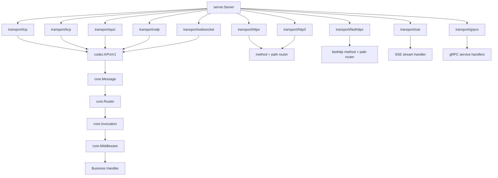
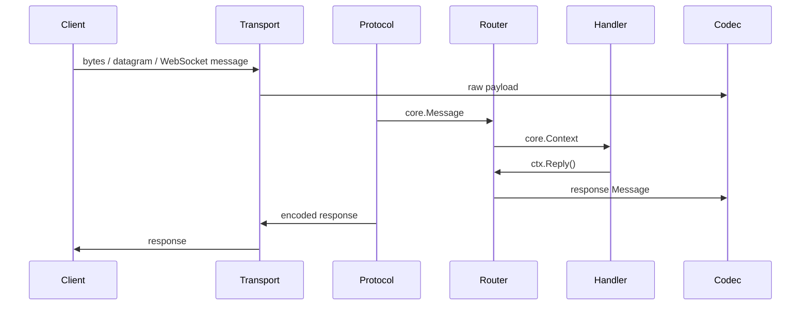
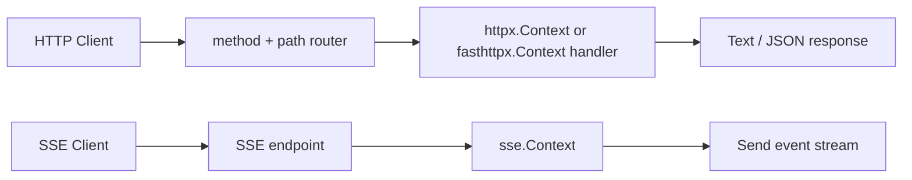

# KPro

English | [中文](README.zh-CN.md)

KPro is a pre-1.0 Go application framework for building a multi-transport app
server behind one application-level programming model.

The design goal is:

```text
business code handles protocol-native handlers or Message / Context
transport code handles TCP, KCP, QUIC, UDP, WebSocket, HTTP, HTTPS, HTTP/2, HTTP/3, SSE, gRPC
protocol code translates bytes, datagrams or frames into Message when applicable
server code assembles transports, middleware and routers
```

## Status

`v0.2.0` and current `main` require Go 1.26.9 or newer. This minor release drops Go
1.25 support to adopt security fixes in the toolchain and dependencies.

Current implementation:

```text
TCP         implemented
KCP         implemented
QUIC        implemented as KPro message streams over QUIC
UDP         implemented
WebSocket   implemented, supports RFC 6455 data-message fragmentation
HTTP        implemented
HTTPS       implemented through HTTP + TLS config
HTTP/2      implemented through HTTPS native Go negotiation
Fast HTTP/1.1 implemented as opt-in transport/fasthttpx
HTTP/3      implemented through QUIC + TLS config
SSE         implemented
gRPC        implemented through transport/grpcx and generic server mounting
```

Implemented means the code path and repository-level tests exist; it is not a
production certification or a capacity/availability guarantee. `v0.1.0` is the
initial developer release. `v0.2.0` introduces source-incompatible API changes;
current `main` may include later unreleased work. Pin an exact version or reviewed commit, use the documentation at
that revision, and validate the framework against the target workload.

Developer and operational support currently includes checked server
construction and component preflight validation, transport capability
descriptors, `cmd/kpro` service scaffolding, versioned local template overlays,
contract code generation, typed OpenAPI HTTP clients, a read-only contract
catalog, optional OTel/Prometheus/Zap/health packages, and CI-enforced
Router/HTTP/outbound/codec microbenchmark budgets. Built-in message transports
also expose bounded aggregate outbound statistics and share a public transport
conformance suite. OTel exporters,
telemetry backends, deployment sizing, and workload-specific validation remain
application or platform responsibilities.

## Start Here

| Goal | Guide |
| --- | --- |
| Re-enter project analysis quickly | [Analysis Index](docs/analysis-index.md) |
| Understand package ownership and runtime flow | [Project Map](docs/project-map.md) |
| Review the current scored framework quality baseline | [Framework Quality Assessment](docs/framework-quality-assessment.md) |
| Run an example or scaffold a unified HTTP, gRPC, or Message service | [10-Minute Quick Start](docs/quickstart.md) |
| Scaffold, inspect, extend, or generate a contract-driven service | [Code Generation](docs/code-generation.md) |
| Add health, Prometheus, Zap, and OTel wiring | [Observability Example](examples/observability/main.go) |
| Choose protocols and application structure | [Recommended Golden Path](docs/golden-path.md) |
| Understand compile-time dependency boundaries | [Dependency Boundaries](docs/dependency-boundaries.md) |
| Prepare a deployment | [Production Readiness Checklist](docs/production-readiness.md) |
| Plan failure recovery and capacity | [Operations and Capacity Planning](docs/operations.md) |
| Preserve client addresses behind an L4 load balancer | [HAProxy PROXY Protocol](docs/proxy-protocol.md) |
| Understand compatibility expectations | [API Stability, Versioning, and Deprecation](docs/api-stability.md) |
| Prepare an open-source release | [Open-source release checklist](docs/open-source-release.md) |
| Add a transport, middleware, codec, or database adapter | [Extending KPro](docs/extending-kpro.md) |

The current documentation tracks unreleased `main`. Create a starter service
from this checkout:

```sh
go run ./cmd/kpro new ../hello-kpro --module example.com/hello-kpro \
  --name hello-kpro --profile service --api http
```

All subcommands accept `--help`; displaying help is a successful command. The
KPro root module contains no repository-local `replace`, but source-mode
scaffolding deliberately adds a local KPro `replace` to the generated
application so it can build against the checkout. Remove that replacement and
pin a reachable release before distributing the generated module.

A versioned CLI install is valid only after the selected tag is available
through the module's declared path:

```sh
go install github.com/saramand9/kpro/cmd/kpro@vX.Y.Z
```

For a private source, configure VCS credentials and `GOPRIVATE` for that module
path. `GOPRIVATE` does not authenticate Git access. Until the declared path and
tag are reachable, use `go run ./cmd/kpro` from a reviewed checkout or a
verified release archive; a successful local checkout build does not prove the
versioned install path.

Current unified `service` projects can add gRPC later without rewriting the
application entry point:

```sh
go run ./cmd/kpro add --root ../hello-kpro --api grpc
cd ../hello-kpro
go mod tidy
go test ./...
kpro generate --check
```

`add` requires the protobuf tools reported by `kpro doctor`, updates the
service selection, manifest, protobuf contract, generated outputs, and lock as
one checked transaction, and is a no-op when gRPC is already present. It does
not edit `cmd/<service>/main.go` or run `go mod tidy`. See
[Code Generation](docs/code-generation.md#add-grpc-to-a-service) for supported
project versions and safety behavior.

Contract-driven projects can also inspect their declared APIs without scanning
application Go code or starting the server:

```sh
kpro list api --root ../hello-kpro
kpro describe service --root ../hello-kpro
```

OpenAPI generation includes a typed `contract.API` HTTP client alongside the
server adapter. Organizations that need a repeatable project shape can pass a
strict local `kpro.dev/scaffold-template/v1alpha1` overlay to
`kpro new --template <directory>`; overlays are declarative and never execute
template hooks or remote content.

The tagged `v0.1.0` CLI and documentation remain internally consistent but
predate the dependency-neutral mounting API. Do not combine source examples
from `main` with a binary or module pinned to `v0.1.0`.

Authentication and authorization are application or gateway integrations and are outside the minimal framework quickstart.

See [CHANGELOG.md](CHANGELOG.md) for repository changes and
[CONTRIBUTING.md](CONTRIBUTING.md) before proposing a change.

## Architecture

High-level structure:



```text
cmd/
  app/                     current application server

core/
  Message                  business packet
  Context                  handler context
  Session                  transport-neutral send/close handle
  Router                   msgID router and middleware chain
  Invocation               unified middleware context
  Middleware               shared invocation middleware

codec/
  StreamCodec           stream decoder/encoder, used by TCP
  PacketCodec           packet decoder/encoder, used by UDP/WebSocket
  KProV1                   default binary protocol

transport/
  transport.go             common transport interfaces
  tcp/                     TCP stream transport
  kcp/                     KCP reliable UDP stream transport
  quic/                    QUIC stream transport
  udp/                     UDP packet transport
  websocket/               WebSocket transport
  httpx/                   HTTP/HTTPS path-routed transport
  fasthttpx/               optional fasthttp-native HTTP/1.1 transport
  http3/                   HTTP/3 path-routed transport over QUIC
  grpcx/                   gRPC server wrapper and generated-style bindings
  sse/                     Server-Sent Events transport

transport/grpcx/
  Server                   gRPC runner and service registrar
  Middleware bridge        unary/stream RPC -> core.Invocation

middleware/
  Recover / RateLimit / MaxPayload / Metrics
                           unified invocation middleware

server/
  Server                   universal assembly layer
  Endpoint                 transport + middleware + router
```

The core runtime path for Message-based transports is:



```text
	TCP / KCP / QUIC / UDP / WebSocket
  -> transport reads bytes, datagram or WebSocket message
  -> protocol decodes core.Message
  -> core.Router dispatches by Message.ID
  -> queue / scheduling
  -> core.Invocation
  -> core.Middleware
  -> business handler
  -> ctx.Reply / session.Send
  -> protocol encodes response
  -> transport writes response
```

HTTP endpoints keep protocol-native method + path routing:



```text
HTTP / HTTPS
  -> path + method router
  -> core.Invocation
  -> core.Middleware
  -> httpx.Context or fasthttpx.Context

SSE
  -> HTTP streaming endpoint
  -> core.Invocation
  -> core.Middleware at stream setup
  -> sse.Context.Send(event, data)
```

## Default Protocol

`codec.KProV1()` is the default binary codec.

```text
20-byte big-endian header + body

uint16 magic       0x4b50
uint8  version     1
uint8  flags
uint32 message id
uint64 sequence
uint32 body length
bytes  body
```

Built-in message IDs:

```text
1          heartbeat
2          pong
0xffffffff error
```

Application message IDs are user-defined. The examples below use `100` as a local echo message ID.

## Multi-Transport API Sketch

Use [the quickstart](docs/quickstart.md) as the application template. The dense sketch below is an API inventory for mounting many protocols; it intentionally omits the full signal, timeout, resource, and deployment setup described by the [golden path](docs/golden-path.md).

```go
package main

import (
	"context"
	"log"
	"time"

	"github.com/saramand9/kpro/codec"
	"github.com/saramand9/kpro/core"
	"github.com/saramand9/kpro/middleware"
	"github.com/saramand9/kpro/server"
	http3x "github.com/saramand9/kpro/transport/http3"
	"github.com/saramand9/kpro/transport/httpx"
	"github.com/saramand9/kpro/transport/kcp"
	quictransport "github.com/saramand9/kpro/transport/quic"
	"github.com/saramand9/kpro/transport/sse"
	"github.com/saramand9/kpro/transport/tcp"
	"github.com/saramand9/kpro/transport/udp"
	"github.com/saramand9/kpro/transport/websocket"
)

const msgEcho uint32 = 100

func main() {
	app, err := server.NewChecked(server.Config{Name: "gateway"})
	if err != nil {
		log.Fatal(err)
	}
	metrics := middleware.NewMetrics()

	app.Mount(tcp.New(tcp.Config{
		Addr:  ":8088",
		Codec: codec.KProV1(),
	})).Use(middleware.Recover(), metrics.Middleware()).
		Handle(msgEcho, echo)

	app.Mount(kcp.New(kcp.Config{
		Addr:  ":8090",
		Codec: codec.KProV1(),
	})).Use(middleware.Recover(), metrics.Middleware()).
		Handle(msgEcho, echo)

	app.Mount(quictransport.New(quictransport.Config{
		Addr:     ":8444",
		Codec:    codec.KProV1(),
		CertFile: "server.crt",
		KeyFile:  "server.key",
	})).Use(middleware.Recover(), metrics.Middleware()).
		Handle(msgEcho, echo)

	app.Mount(udp.New(udp.Config{
		Addr:          ":8089",
		Codec:         codec.KProV1(),
		MaxPacketSize: 2048,
	})).Use(middleware.Recover(), metrics.Middleware()).
		Handle(msgEcho, echo)

	app.Mount(websocket.New(websocket.Config{
		Addr:       ":8091",
		Path:       "/ws",
		Codec:      codec.KProV1(),
		MaxMessage: 64 * 1024,
	})).Use(middleware.Recover(), metrics.Middleware()).
		Handle(msgEcho, echo)

	httpEndpoint := server.MountNative(app, httpx.New(httpx.Config{Addr: ":8080"}))
	httpEndpoint.Get("/health", func(ctx *httpx.Context) error {
			return ctx.Text(200, "ok\n")
		}).
		Get("/metrics", func(ctx *httpx.Context) error {
			return ctx.JSON(200, metrics.Snapshot())
		}).
		Post("/echo", func(ctx *httpx.Context) error {
			body, err := ctx.Body()
			if err != nil {
				return err
			}
			return ctx.JSON(200, map[string]interface{}{"echo": string(body)})
		})

	http3Endpoint := server.MountNative(app, http3x.New(http3x.Config{
		Addr:     ":8443",
		CertFile: "server.crt",
		KeyFile:  "server.key",
	}))
	http3Endpoint.Get("/health", func(ctx *http3x.Context) error {
		return ctx.Text(200, "ok\n")
	})

	sseEndpoint := server.MountNative(app, sse.New(sse.Config{Addr: ":8081", Path: "/events"}))
	sseEndpoint.Handle(func(ctx *sse.Context) error {
			ticker := time.NewTicker(time.Second)
			defer ticker.Stop()
			for {
				select {
				case <-ctx.Done():
					return nil
				case t := <-ticker.C:
					if err := ctx.Send("time", []byte(t.Format(time.RFC3339))); err != nil {
						return err
					}
				}
			}
		})

	handle, err := app.Start(context.Background())
	if err != nil {
		log.Fatal(err)
	}
	readyCtx, cancelReady := context.WithTimeout(context.Background(), 15*time.Second)
	defer cancelReady()
	if err := handle.WaitReady(readyCtx); err != nil {
		log.Fatal(err)
	}
	if err := handle.Wait(); err != nil {
		log.Fatal(err)
	}
}

func echo(ctx core.Context) error {
	msg := ctx.Message()
	return ctx.Reply(msg.ID, msg.Data)
}
```

## Run

```powershell
# Run from the repository root.
go run .\cmd\app -tcp :8088 -kcp :8090 -udp :8089 -ws :8091 -http :8080 -sse :8081 -gorm-driver sqlite -gorm-dsn file:kpro-app.db
```

HTTP/3 is disabled by default in the app server because it requires TLS
certificates and listens on UDP:

```powershell
go run .\cmd\app -http3 :8443 -http3-cert server.crt -http3-key server.key
```

QUIC message transport is also disabled by default because it requires TLS
certificates and listens on UDP:

```powershell
go run .\cmd\app -quic :8444 -quic-cert server.crt -quic-key server.key
```

Limit active QUIC stream sessions with:

```powershell
go run .\cmd\app -quic :8444 -quic-cert server.crt -quic-key server.key -quic-max-streams 10000
```

HTTP validation:

```powershell
Invoke-RestMethod -Uri http://127.0.0.1:8080/livez
Invoke-RestMethod -Uri http://127.0.0.1:8080/readyz
Invoke-RestMethod -Uri http://127.0.0.1:8080/echo -Method Post -Body "hello" -ContentType "text/plain"
```

`/health` remains a compatibility alias for readiness. Readiness requires the
whole application server to be running. When GORM is enabled, it also performs
a bounded SQL ping. The probe returns only `ready` or `not_ready` and does not
expose the dependency error.

## Examples

Standalone examples live under [examples/](examples/). Start with
`examples/quickstart` for the recommended lifecycle shape. Protocol-specific
server/client pairs are focused demonstrations of transport behavior, not
complete deployment templates:

```text
examples/quickstart
examples/observability
examples/tcp/server          examples/tcp/client
examples/kcp/server          examples/kcp/client
examples/quic/server         examples/quic/client
examples/udp/server          examples/udp/client
examples/websocket/server    examples/websocket/client
examples/http/server         examples/http/client
examples/fasthttp/server     examples/http/client
examples/https/server        examples/https/client
examples/http2/server        examples/http2/client
examples/http3/server        examples/http3/client
examples/sse/server          examples/sse/client
examples/grpc/server         examples/grpc/client
```

See [examples/README.md](examples/README.md) for startup commands.

## Design Notes

- TCP, KCP and QUIC are stream-oriented, so they use `codec.StreamCodec`.
- UDP and WebSocket have message boundaries, so they use `codec.PacketCodec`.
- HTTP/HTTPS keep native Go `ServeMux` method + path-pattern routing, including path parameters, groups, and route-local middleware; they do not convert requests into `core.Message`.
- `fasthttpx` is an optional HTTP/1.1-only native runner with its own borrowed
  context API. It reuses KPro lifecycle and middleware but does not emulate
  `net/http` or negotiate HTTP/2; see [Fast HTTP/1.1 Endpoint](docs/fasthttp.md).
- HTTP/3 uses the same path-routing handler model over QUIC/UDP and requires TLS certificates.
- TCP, HTTP/HTTPS/HTTP2, fasthttp, WebSocket, SSE, and gRPC can explicitly
  require HAProxy PROXY protocol v1/v2 from a trusted proxy IP/CIDR allowlist.
  It is disabled by default and parsed before TLS; see
  [HAProxy PROXY Protocol](docs/proxy-protocol.md).
- WebSocket upgrades default to a same-host `Origin` check when the header is
  present; use `Config.CheckOrigin` for an explicit cross-origin allowlist.
- HTTP/3 shutdown sends GOAWAY and drains accepted requests until its deadline.
  A mounted message Endpoint optionally quiesces new transport dispatch, drains
  accepted Router work, drains accepted transport writes, and then shuts down
  the transport. TCP, KCP, QUIC, UDP, and WebSocket implement both optional
  phases; custom transports fall back to the capabilities they expose.
  Successful outbound drain proves completion of each transport write call,
  not peer processing or durable delivery.
- `core.BackpressureWait` has independent blocked-caller bounds (1024 globally
  and 16 per session by default). A dispatch consumes only one wait ticket even
  when it crosses global, per-session, and queue admission stages.
- Built-in message sessions expose optional, bounded
  `core.SessionWaitOutboundWritable` support. Success is advisory and reserves
  no capacity for the next `Send`; the send result remains authoritative.
- `core.SessionSendWithReceipt` discovers the optional built-in write-receipt
  capability. Admission errors are returned immediately; an accepted receipt
  completes with the later transport write result. `core.SessionDrainOutbound`
  seals one session against new sends and waits for its accepted writes.
  Direct `Session.Close` remains abortive.
- `Router.Shutdown` drains accepted sync and async work. `Router.Close` is the
  immediate best-effort path and is not a synchronization barrier proving that
  no already-ready queued handler can begin.
- QUIC uses bidirectional QUIC streams as `core.Session` instances and runs KPro messages directly over them. `quic.Config.MaxConnections` caps physical QUIC connections, while `MaxStreams` independently caps active bidirectional stream sessions.
- `server.Server.Use(...)` installs unified `core.Middleware` for TCP, KCP, QUIC, UDP, WebSocket, HTTP, HTTPS, HTTP/3, SSE and gRPC endpoints mounted before or after the call.
- `core.Middleware` runs on `core.Invocation`; TCP, KCP, QUIC, UDP and WebSocket build the invocation at real handler execution time after Router scheduling.
- `core.RouterConfig.ErrorObserver` receives payload-free handler, panic, and
  error-response failures. Its original errors, peer address, and panic stack
  are internal diagnostics and still require the application's redaction policy.
- `server.NewChecked` validates server configuration, while `Start`/`Run` preflight mounted `transport.Validator` components before serving; `server.New` remains the permissive compatibility constructor.
- Built-in transports advertise mode and capabilities through `transport.Descriptor`; `transport.Describe` gives tooling a conservative fallback for older custom components.
- `prometheusx` uses bounded transport/operation/result labels, `zapx` uses an application logger, `healthx` bounds probe responses, and every health check must honor its context.
- TCP, KCP, QUIC, UDP, and WebSocket implement
  `transport.OutboundSnapshotter`; `prometheusx.NewOutboundCollector` exports
  current queue pressure plus accepted/success/error/drop and drain counters
  without connection IDs or peer-address labels.
- `otelx` instruments invocations with an application-supplied or global provider; the application configures and owns the SDK, sampler, exporter, flush, and shutdown lifecycle.
- SSE is one-way server push and has its own `sse.Context`; the stream setup can reuse unified `core.Middleware`.
- HTTP and HTTPS first attempt graceful drain; a failed or expired drain
  force-closes remaining non-hijacked HTTP connections and returns the shutdown
  error. SSE first cancels stream request contexts, then uses the same bounded
  drain and force-close fallback. A connection explicitly hijacked through
  `net/http` is caller-owned.
- gRPC uses native service and method routing. Unary and stream RPCs reuse unified `core.Middleware` through `server.MountNative` / `grpcx.Server.Use`; they are not converted into `core.Message`.
- The framework avoids exposing a Netty-style pipeline API. The public model is `Protocol + Middleware + Router + Handler`.
- App server usage is documented in [docs/app-server.md](docs/app-server.md).
- GORM database and eventing architecture are documented in [docs/database-architecture.md](docs/database-architecture.md).
- More detailed call-flow diagrams are in [docs/call-flow.md](docs/call-flow.md).
- TCP internal flow guide is in [docs/tcp-internal-flow.md](docs/tcp-internal-flow.md).
- Network correctness requirements for message-based transports are in [docs/network-test-requirements.md](docs/network-test-requirements.md).
- Custom message transports can run the same live lifecycle/session contract as
  all five built-ins through the public `transport/transporttest` package; see
  [Extending KPro](docs/extending-kpro.md).
- Implemented write fast paths and the Netty comparison contract are in [docs/performance-fast-path.md](docs/performance-fast-path.md).
- The source-based KPro/Netty performance and concurrency baseline is in [docs/netty-performance-baseline.md](docs/netty-performance-baseline.md).
- The complete documentation index is [docs/README.md](docs/README.md).

## Test

```powershell
$env:GOCACHE='C:\tmp\go-build-kpro'
gofmt -l .
go test ./...
go vet ./...
go test -race ./...
```

Run the deterministic TCP slow-write, short/partial-write, deadline,
half-close, reset, and connection-fanout matrix directly with:

```powershell
go test -race -count=1 -timeout=3m ./transport/tcp -run '^TestTCPFault'
```

The 1,000-connection shutdown and configurable real-socket soak cases are
opt-in. See
[Transport Fault Injection And Soak Testing](docs/transport-resilience-testing.md)
for local commands and the manual `Transport resilience` workflow.

Run the same selected hot-path budget guard used by CI:

```powershell
go test -p 1 ./core ./transport/httpx ./transport/internal/outbound ./transport/internal/dispatchgate ./transport/tcp ./transport/websocket ./benchmark -run '^$' -bench 'Benchmark(RouterDispatchSync|EndpointServeHTTP|OutboundQueueRoundTrip|OutboundQueueDrainAvailable|GateBeginEnd|KProCodec|SessionSendContiguous|SessionSendSegmented|ReserveOutboundBufferCommit|TCPSessionBatchWrite16x1KiB|WebSocketSessionBatchWrite16x1KiB)$' -benchmem -benchtime=250ms -count=3 > benchmark-current.txt
go run ./cmd/benchguard -budget benchmark/budgets.json -input benchmark-current.txt
```

The thresholds in [benchmark/budgets.json](benchmark/budgets.json) are
regression guards, not service capacity or latency guarantees. `benchguard`
uses median `ns/op` across samples and requires every `B/op` and
`allocs/op` sample to pass. CI also tests and vets the comparison module:

```powershell
cd .\benchmark\compare
go test ./...
go vet ./...
```

## License

KPro is licensed under the [Apache License 2.0](LICENSE).
