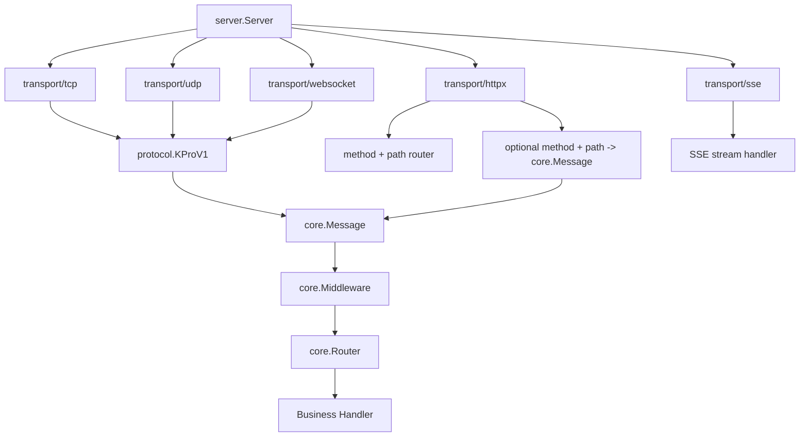
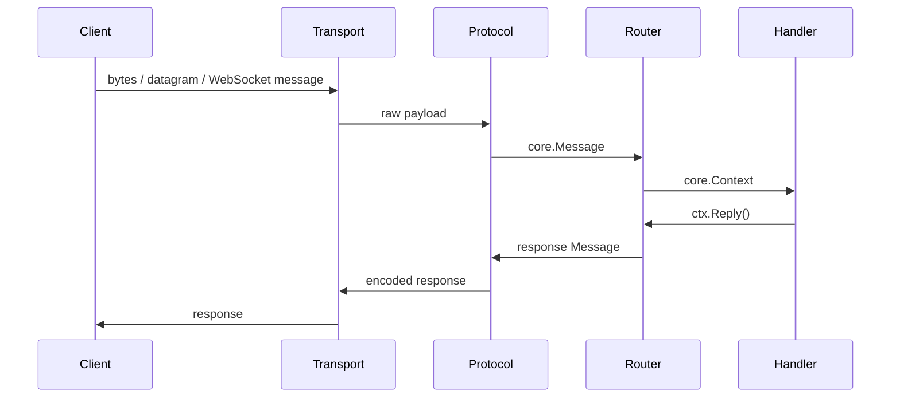
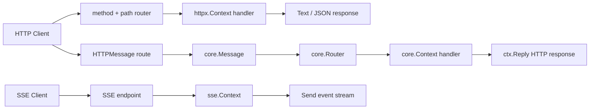

# KPro

KPro is a Go network framework experiment for building a "universal server" that can host multiple protocol transports behind one application-level programming model.

The design goal is:

```text
business code handles Message / Context
transport code handles TCP, UDP, WebSocket, HTTP, HTTPS, SSE
protocol code translates bytes, datagrams or frames into Message
server code assembles transports, middleware and routers
```

## Status

Current implementation:

```text
TCP         implemented
UDP         implemented
WebSocket   implemented, supports RFC 6455 data-message fragmentation
HTTP        implemented
HTTPS       implemented through HTTP + TLS config
SSE         implemented
```

There is also a legacy production TCP baseline in the root `kpro` package. The universal server is built in subpackages such as `server`, `core`, `protocol` and `transport`.

## Architecture

High-level structure:



```text
cmd/
  kpro-client/             TCP benchmark client
  kpro-server/             legacy TCP echo server
  kpro-universal-server/   multi-transport example server

core/
  Message                  business packet
  Context                  handler context
  Session                  transport-neutral send/close handle
  Router                   msgID router and middleware chain

protocol/
  StreamProtocol           stream decoder/encoder, used by TCP
  PacketProtocol           packet decoder/encoder, used by UDP/WebSocket
  KProV1                   default binary protocol

transport/
  transport.go             common transport interfaces
  tcp/                     TCP stream transport
  udp/                     UDP packet transport
  websocket/               WebSocket transport
  httpx/                   HTTP/HTTPS path-routed transport and optional message bridge
  sse/                     Server-Sent Events transport

middleware/
  Recover                  panic recovery
  MaxPayload               payload size guard

server/
  Server                   universal assembly layer
  Endpoint                 transport + middleware + router
```

The core runtime path for Message-based transports is:



```text
TCP / UDP / WebSocket
  -> transport reads bytes, datagram or WebSocket message
  -> protocol decodes core.Message
  -> endpoint middleware
  -> core.Router dispatches by Message.ID
  -> business handler
  -> ctx.Reply / session.Send
  -> protocol encodes response
  -> transport writes response
```

HTTP and HTTPS have two explicit modes:



```text
HTTP / HTTPS
  -> path + method router
  -> httpx.Context

HTTPMessage / HTTPSMessage
  -> path + method router maps to Message.ID
  -> core.Router dispatches by Message.ID
  -> core.Context / ctx.Reply

SSE
  -> HTTP streaming endpoint
  -> sse.Context.Send(event, data)
```

## Default Protocol

`protocol.KProV1()` is the default binary protocol.

```text
20-byte big-endian header + body

uint16 magic       0x4b50
uint8  version     1
uint8  flags
uint32 message id
uint64 sequence
uint32 body length
bytes  body
```

Built-in message IDs:

```text
1          heartbeat
2          pong
100        echo
0xffffffff error
```

## Universal Server Example

```go
package main

import (
	"log"
	"time"

	"github.com/saramand9/bignet/kpro/core"
	"github.com/saramand9/bignet/kpro/middleware"
	"github.com/saramand9/bignet/kpro/protocol"
	"github.com/saramand9/bignet/kpro/server"
	"github.com/saramand9/bignet/kpro/transport/httpx"
	"github.com/saramand9/bignet/kpro/transport/sse"
	"github.com/saramand9/bignet/kpro/transport/tcp"
	"github.com/saramand9/bignet/kpro/transport/udp"
	"github.com/saramand9/bignet/kpro/transport/websocket"
)

func main() {
	app := server.New(server.Config{Name: "gateway"})

	app.TCP(":8088", tcp.Config{
		Protocol: protocol.KProV1(),
	}).Use(middleware.Recover()).
		Handle(core.MsgEcho, echo)

	app.UDP(":8089", udp.Config{
		Protocol:      protocol.KProV1(),
		MaxPacketSize: 2048,
	}).Use(middleware.Recover()).
		Handle(core.MsgEcho, echo)

	app.WebSocket(":8091", "/ws", websocket.Config{
		Protocol:   protocol.KProV1(),
		MaxMessage: 64 * 1024,
	}).Use(middleware.Recover()).
		Handle(core.MsgEcho, echo)

	app.HTTP(":8080").
		Get("/health", func(ctx *httpx.Context) error {
			return ctx.Text(200, "ok\n")
		}).
		Post("/echo", func(ctx *httpx.Context) error {
			body, err := ctx.Body()
			if err != nil {
				return err
			}
			return ctx.JSON(200, map[string]interface{}{"echo": string(body)})
		})

	app.HTTPMessage(":8082").
		Post("/message/echo", core.MsgEcho).
		Handle(core.MsgEcho, echo)

	app.SSE(":8081", "/events").
		Handle(func(ctx *sse.Context) error {
			ticker := time.NewTicker(time.Second)
			defer ticker.Stop()
			for {
				select {
				case <-ctx.Done():
					return nil
				case t := <-ticker.C:
					if err := ctx.Send("time", []byte(t.Format(time.RFC3339))); err != nil {
						return err
					}
				}
			}
		})

	log.Fatal(app.ListenAndServe())
}

func echo(ctx core.Context) error {
	msg := ctx.Message()
	return ctx.Reply(msg.ID, msg.Data)
}
```

## Run

```powershell
cd D:\dev\saramand9\bignet\kpro
go run .\cmd\kpro-universal-server -tcp :8088 -udp :8089 -ws :8091 -http :8080 -sse :8081
```

TCP validation:

```powershell
go run .\cmd\kpro-client -addr 127.0.0.1:8088 -conns 1000 -rate 1 -duration 60s -ramp 10s
```

HTTP validation:

```powershell
Invoke-RestMethod -Uri http://127.0.0.1:8080/health
Invoke-RestMethod -Uri http://127.0.0.1:8080/echo -Method Post -Body "hello" -ContentType "text/plain"
```

## Examples

Standalone examples live under [examples/](examples/). Each protocol has a server and client:

```text
examples/tcp/server          examples/tcp/client
examples/udp/server          examples/udp/client
examples/websocket/server    examples/websocket/client
examples/http/server         examples/http/client
examples/https/server        examples/https/client
examples/sse/server          examples/sse/client
```

See [examples/README.md](examples/README.md) for startup commands.

## Legacy TCP Server

The root package also contains the earlier production-oriented TCP baseline:

```text
accept loop
  -> per-connection reader goroutine
  -> bounded global worker queue
  -> worker pool
  -> bounded per-connection send queue
  -> per-connection writer goroutine
```

Run it with:

```powershell
go run .\cmd\kpro-server -host 0.0.0.0 -port 8088 -max-conns 10000 -workers 16
```

This path is useful for TCP load validation. The universal server path is the framework direction.

## Design Notes

- TCP is stream-oriented, so it uses `protocol.StreamProtocol`.
- UDP and WebSocket have message boundaries, so they use `protocol.PacketProtocol`.
- HTTP/HTTPS support native path routing for REST-style APIs and `HTTPMessage` / `HTTPSMessage` for TCP-like `core.Router` reuse.
- SSE is one-way server push and has its own `sse.Context`.
- The framework avoids exposing a Netty-style pipeline API. The public model is `Protocol + Middleware + Router + Handler`.
- More detailed call-flow diagrams are in [docs/call-flow.md](docs/call-flow.md).
- TCP internal flow guide is in [docs/tcp-internal-flow.md](docs/tcp-internal-flow.md).
- Network correctness requirements for message-based transports are in [docs/network-test-requirements.md](docs/network-test-requirements.md).

## Test

```powershell
$env:GOCACHE='C:\tmp\go-build-bignet-kpro'
go test ./...
```
