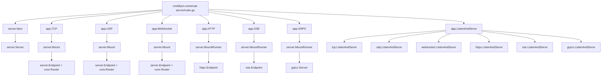
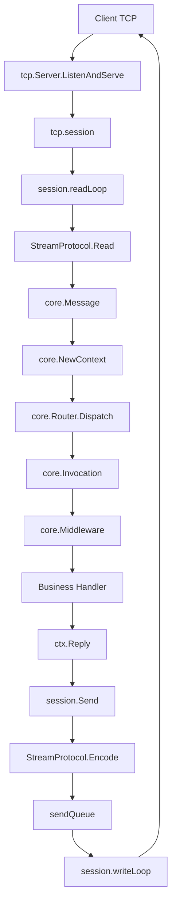
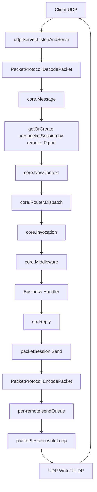
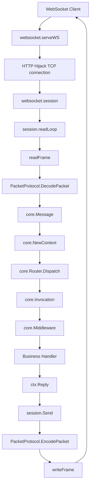
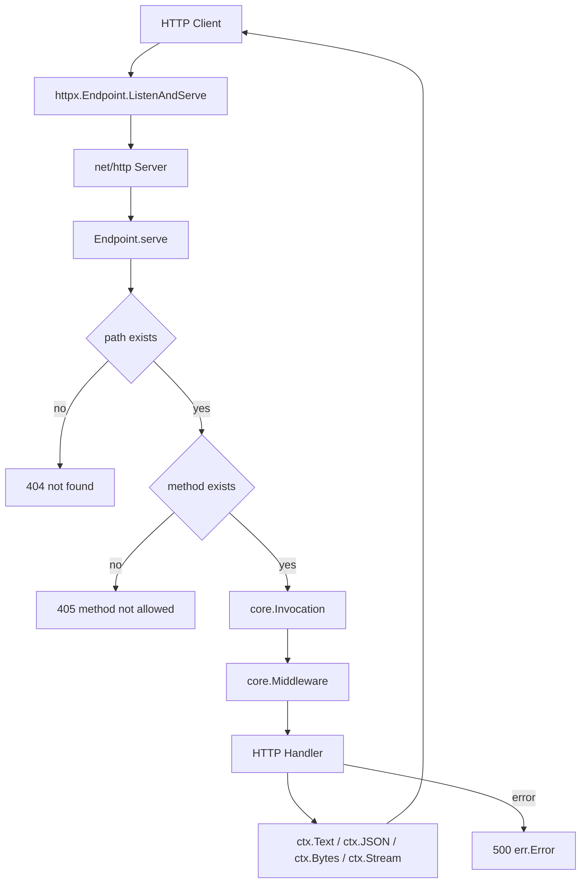
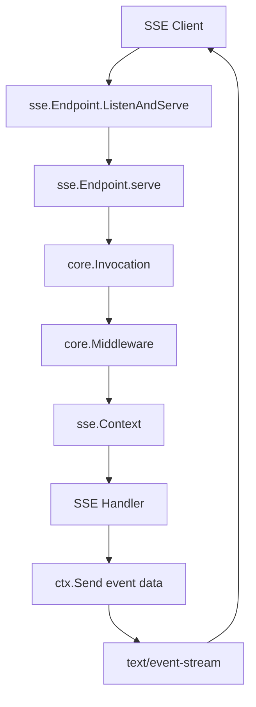
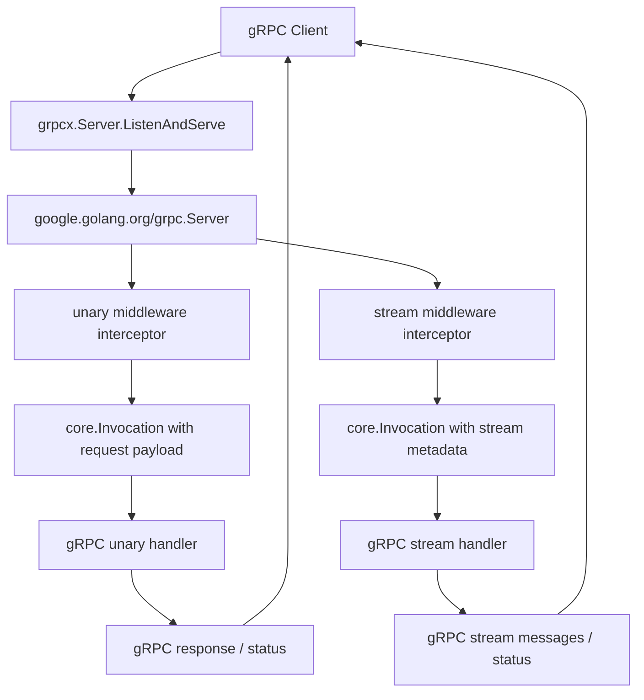
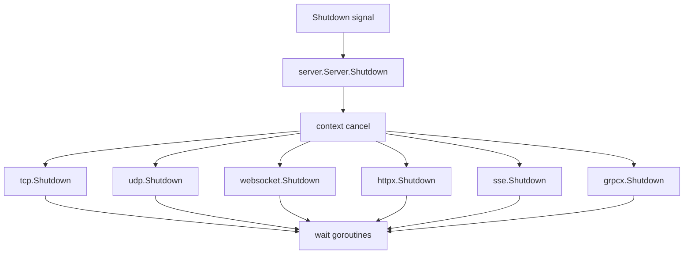

# KPro call flow

This document shows the runtime call paths for the current KPro universal server implementation.

## Startup



## Message-Based Transports

TCP, UDP and WebSocket share the same message business model:

```text
transport input
  -> protocol decode
  -> core.NewContext
  -> core.Router.Dispatch
  -> queue / scheduling
  -> core.Invocation
  -> core.Middleware chain
  -> business handler
  -> ctx.Reply
  -> protocol encode
  -> transport output
```

## TCP



Key files:

```text
transport/tcp/server.go
protocol/kpro.go
core/context.go
core/router.go
```

## UDP



UDP has no real connection. KPro maps each remote IP:port to a virtual session. Each virtual session owns its own bounded send queue and writer goroutine, and idle sessions are cleaned up by timeout.

## WebSocket



WebSocket currently treats one WebSocket message as one protocol packet.

## HTTP / HTTPS

HTTP and HTTPS keep protocol-native method + path routing.

This is appropriate for REST-style APIs:




## SSE



SSE is a one-way server push transport. It is intentionally not modeled as request/reply. The stream setup can still enter unified `core.Middleware`, using operation keys such as `GET /events`.

## gRPC

gRPC keeps native service and method routing. KPro does not convert gRPC requests into `core.Message`; instead unary and stream RPCs enter the shared `core.Middleware` layer before the service handler runs.



The operation key is the full gRPC method, for example `/helloworld.v1.Greeter/SayHello`. Unary payload is the decoded request object. Stream payload is nil at stream setup; stream direction is exposed in metadata.

## Shutdown


