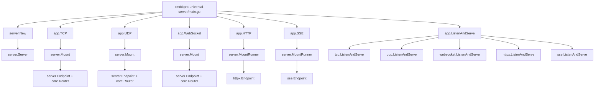
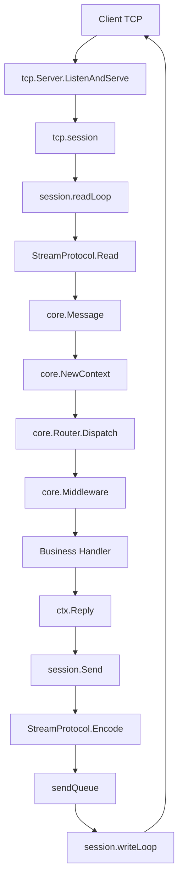
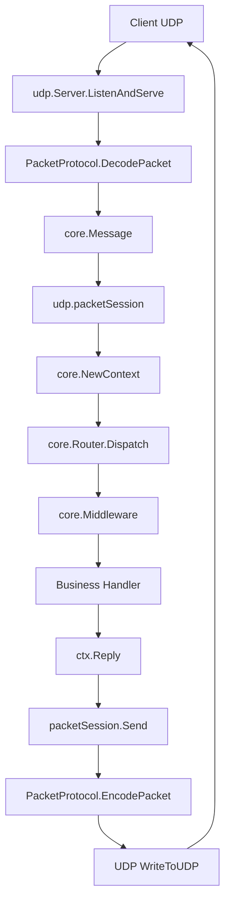
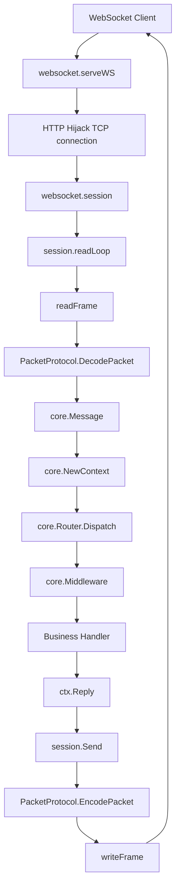
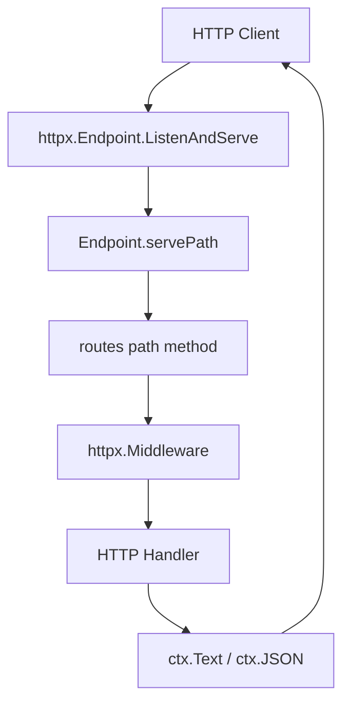
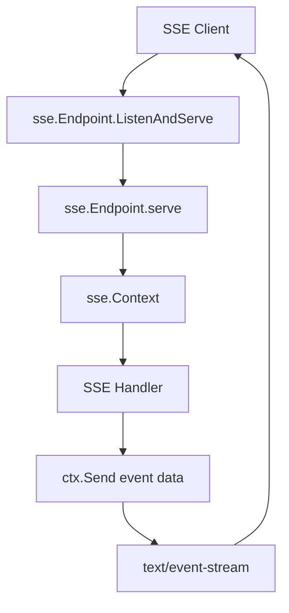
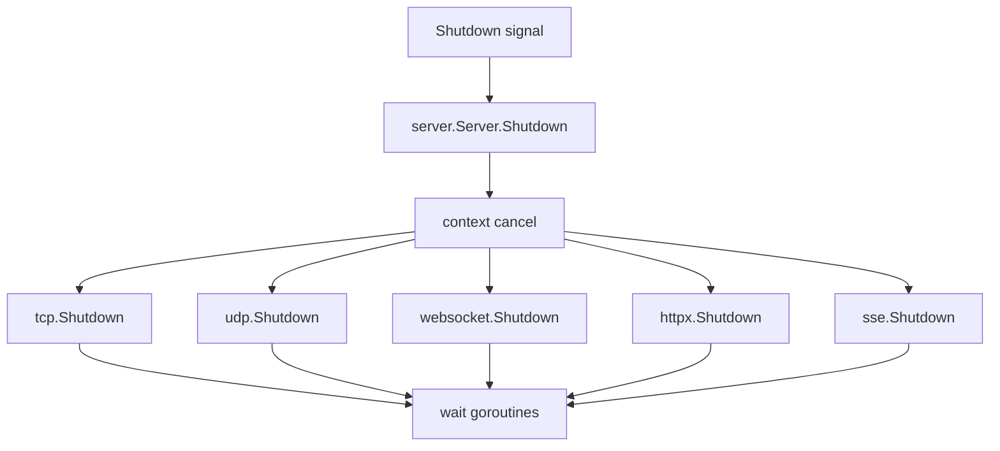

# KPro call flow

This document shows the runtime call paths for the current KPro universal server implementation.

## Startup



## Message-Based Transports

TCP, UDP and WebSocket share the same business model:

```text
transport input
  -> protocol decode
  -> core.NewContext
  -> core.Router.Dispatch
  -> middleware chain
  -> business handler
  -> ctx.Reply
  -> protocol encode
  -> transport output
```

## TCP



Key files:

```text
transport/tcp/server.go
protocol/kpro.go
core/context.go
core/router.go
```

## UDP



UDP has no real connection. KPro maps each remote address to a lightweight virtual session ID.

## WebSocket



WebSocket currently treats one WebSocket message as one protocol packet.

## HTTP / HTTPS



HTTP and HTTPS use method + path routing rather than `core.Message.ID`.

## SSE



SSE is a one-way server push transport. It is intentionally not modeled as request/reply.

## Shutdown


