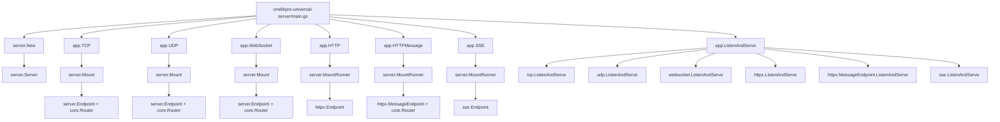
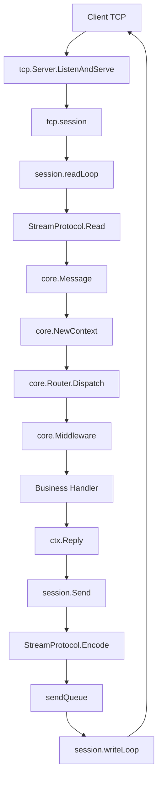
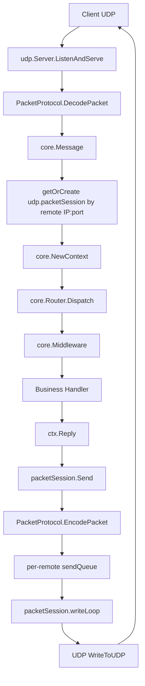
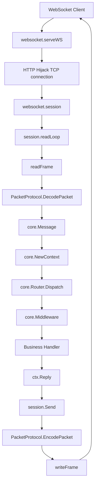
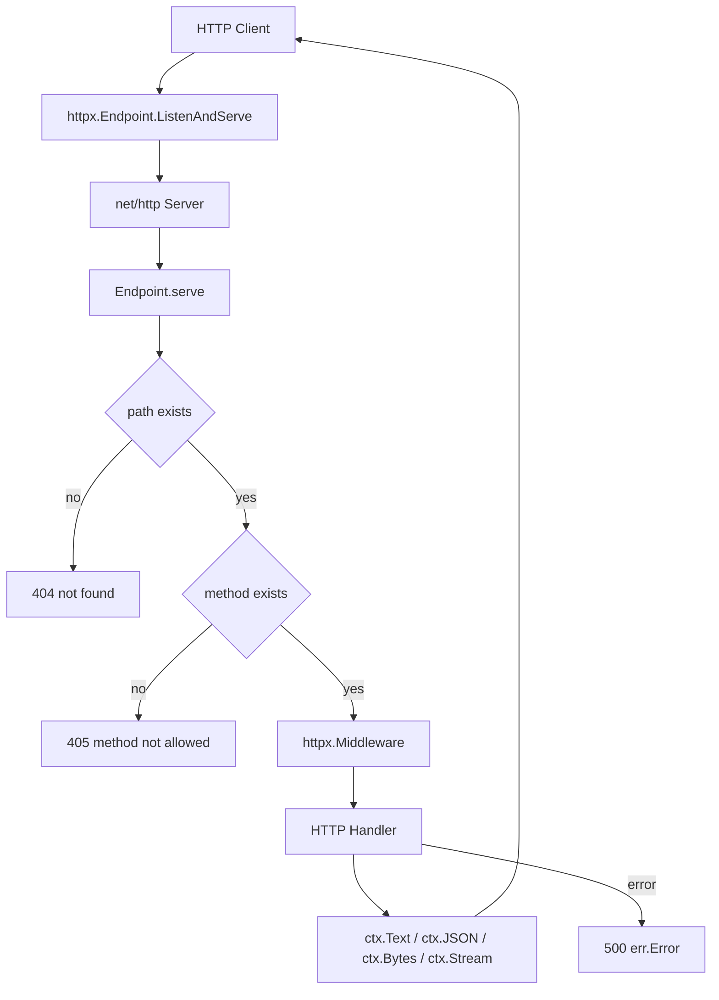
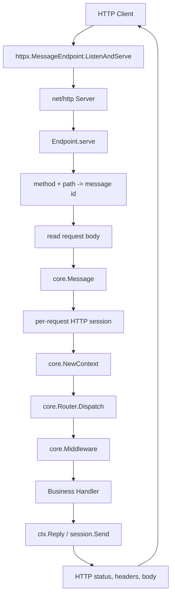
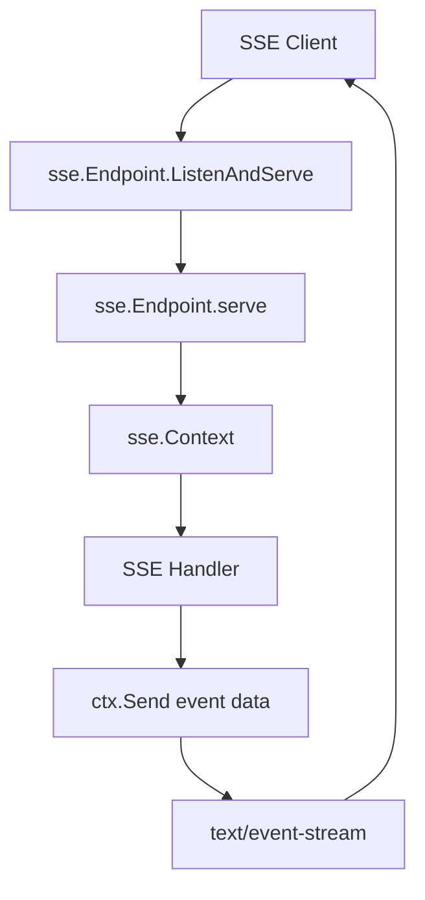
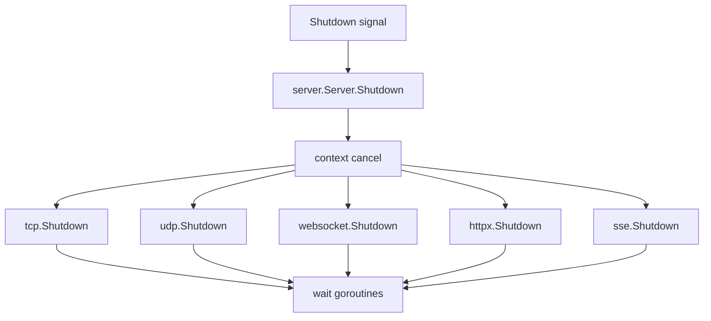

# KPro call flow

This document shows the runtime call paths for the current KPro universal server implementation.

## Startup



## Message-Based Transports

TCP, UDP, WebSocket and the optional HTTP message endpoint share the same business model:

```text
transport input
  -> protocol decode
  -> core.NewContext
  -> core.Router.Dispatch
  -> middleware chain
  -> business handler
  -> ctx.Reply
  -> protocol encode
  -> transport output
```

## TCP



Key files:

```text
transport/tcp/server.go
protocol/kpro.go
core/context.go
core/router.go
```

## UDP



UDP has no real connection. KPro maps each remote IP:port to a virtual session. Each virtual session owns its own bounded send queue and writer goroutine, and idle sessions are cleaned up by timeout.

## WebSocket



WebSocket currently treats one WebSocket message as one protocol packet.

## HTTP / HTTPS

HTTP and HTTPS now have two explicit modes.

The native HTTP mode keeps method + path routing and is appropriate for REST-style APIs:



The message HTTP mode maps method + path routes to `core.Message.ID`, then reuses the same `core.Router`, middleware and sync/async dispatch model as TCP:



`HTTPMessage` and `HTTPSMessage` are the TCP-like entry points. They preserve HTTP protocol semantics at the edge, but business code runs against `core.Context`.

## SSE



SSE is a one-way server push transport. It is intentionally not modeled as request/reply.

## Shutdown


