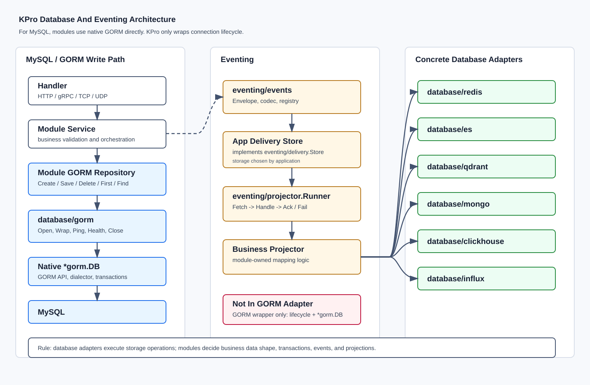

# Database And Eventing Architecture

KPro separates storage adapters from event flow mechanics:

```text
database  = concrete storage clients and lifecycle resources
eventing  = events, delivery contracts, and projector scheduling
modules   = business repositories, business events, and concrete projectors
internal/app/persistence = app-level resource composition
```

Transactional MySQL data should use GORM directly in module repositories. Secondary stores such as
Redis, Elasticsearch, Qdrant, Neo4j, MongoDB, ClickHouse, and InfluxDB stay as concrete adapters.



## Name Map

| Package | Meaning |
| --- | --- |
| `internal/app/persistence` | Opens app database resources and owns health/shutdown composition. |
| `database/common/lifecycle` | Shared resource lifecycle, health, and observation types. |
| `database/common/readmodels` | Query-side capabilities such as cache, search, vector, graph, analytics, and metrics. |
| `eventing/events` | Immutable business events, transport envelopes, codecs, and registry. |
| `eventing/delivery` | Reliable event delivery contract only; concrete storage is chosen by the application. |
| `eventing/projector` | Projector interface, registry, and runner. |

The storage adapters keep their database names:

```text
database/gorm        GORM database resource around native gorm.DB
database/redis            Redis cache, lock, stream, and sorted-set adapter
database/es   Elasticsearch index, search, and bulk adapter
database/qdrant          Qdrant vector collection adapter
database/neo4j       Neo4j graph read-model adapter
database/mongo       MongoDB document adapter
database/clickhouse   ClickHouse analytical SQL adapter
database/influx       InfluxDB metrics and Flux query adapter
```

## GORM Write Flow

The default relational write path is intentionally direct:

```text
HTTP/gRPC/TCP handler
-> module service
-> module store port
-> internal/modules/<name>/store
-> store-local GORM row model
-> database/gorm.Database.GORM()
-> native gorm.DB Create / Save / Delete / First / Find
-> MySQL
```

`database/gorm` opens, wraps, checks, and closes native GORM handles. It also provides a small versioned migration runner that records applied versions in `schema_migrations`. Module repositories still use GORM's own API for CRUD and transactions. Domain models stay in module root packages; GORM table rows and mapper functions stay inside the module store package.

## Schema Migrations

Built-in modules declare explicit versioned migrations in their store packages:

```text
internal/modules/users/store.Migrations()
internal/modules/projects/store.Migrations()
```

`store.InitGORM(ctx, database)` applies those migrations through `database/gorm.ApplyMigrations`. The runner sorts migrations by version, skips already applied versions, and records successful runs in `schema_migrations`.

## Model Boundaries

The app keeps protocol, business, and persistence models separate:

```text
HTTP JSON
-> handler request DTO
-> service input DTO
-> module domain model
-> store-local GORM row model
-> database row
-> handler response DTO
```

For example, `internal/modules/users.User` has no `json` or `gorm` tags. The users HTTP handler owns JSON request/response shapes, and `internal/modules/users/store` owns `userRow` plus the domain/row mappers.

## Business Projector Boundary

`eventing/projector` only owns the generic scheduling mechanics:

```text
Projector interface
Registry
Runner
```

Concrete projectors belong to business modules because they know business event semantics and target data shape:

```text
internal/modules/orders/events.go
internal/modules/orders/projectors/search.go     -> writes Elasticsearch
internal/modules/orders/projectors/cache.go      -> writes Redis
internal/modules/orders/projectors/analytics.go  -> writes ClickHouse
```

The database adapters only execute storage operations. They do not decide whether
`order.created` should update Redis, Elasticsearch, ClickHouse, or nothing.

## Adapter Flow Examples

### GORM SQL Path

```text
handler
-> service
-> module store port
-> module GORM repository
-> database/gorm.Database
-> gorm.DB
-> MySQL
```

Typical use:

```text
gormResource := gormstore.Open(...)
stores := NewGORMStores(gormResource)
users service calls users.Store
users.Store maps users.User <-> userRow and calls gorm.DB directly
```

### Redis Path

```text
service or projector
-> database/redis.Cache[T] / Lock / Stream / ZSet
-> go-redis client
-> Redis
```

### Elasticsearch Path

```text
service or projector
-> database/es.Index[T] / SearchRaw / BulkService
-> go-elasticsearch client
-> Elasticsearch
```

### Qdrant Path

```text
service or projector
-> database/qdrant.Collection[T]
-> Qdrant HTTP API
-> Qdrant collection
```

### Neo4j Path

```text
service or projector
-> database/neo4j.Graph
-> neo4j-go-driver
-> Neo4j graph
```

### MongoDB Path

```text
service or projector
-> database/mongo.Collection[T]
-> mongo-driver
-> MongoDB collection
```

### ClickHouse Path

```text
analytics projector or report service
-> database/clickhouse.AnalyticsTable[T] or SQL/Tx
-> clickhouse-go / database/sql
-> ClickHouse
```

### InfluxDB Path

```text
metrics service or projector
-> database/influx.Writer / Measurement[T] / Query
-> influxdb-client-go
-> InfluxDB bucket
```

## Runtime Lifecycle

Every database adapter that owns an external connection implements
`database/common/lifecycle.Resource` where practical:

```text
Name()
Kind()
Ping(ctx)
Health(ctx)
Close()
```

This gives startup, health checks, and graceful shutdown one common contract without forcing all databases into one CRUD abstraction.
