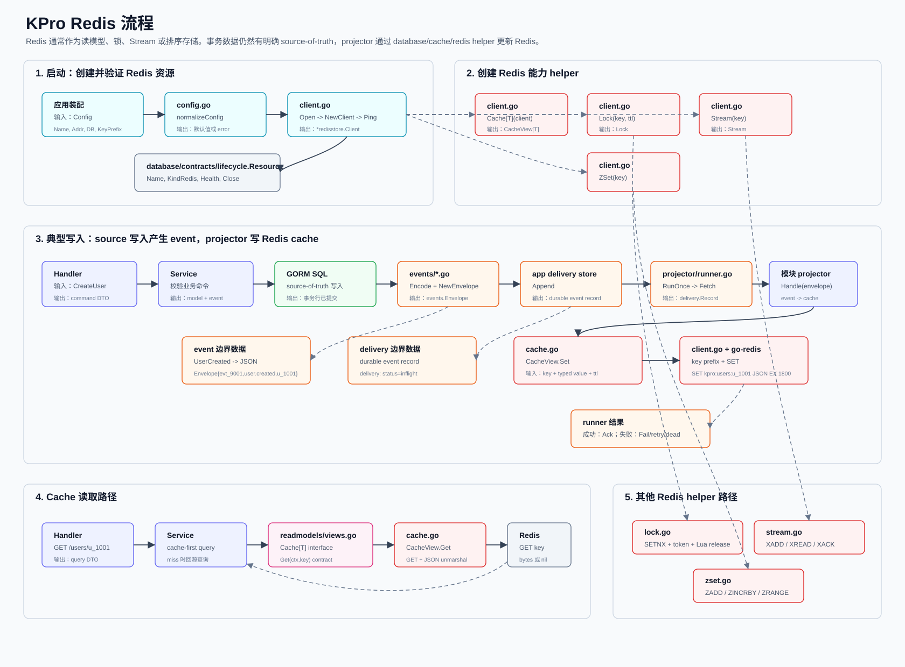

# Redis 流程

这份文档用 Redis 作为一个具体例子，说明数据在 KPro 数据库架构里怎么流转。`database/redis` 目录下的 Redis 适配器已经存在；业务模块仍然需要自己提供 projector、repository 或 service 代码，决定什么时候使用 Redis。



## 核心思路

默认架构里，Redis 通常不是 source of truth，也就是不是事务数据的最终可信来源。更典型的用法是作为读模型：

```text
source-of-truth 写入成功
-> event 写入应用自己的 delivery store
-> projector 消费 event
-> Redis cache / stream / zset 被更新
-> 读请求可以优先读取 Redis
```

如果某个模块明确需要 Redis 做锁、stream、sorted set 或短期缓存，也可以由 service 直接调用 Redis adapter。

## 流程目的总览

| 流程 | 目的 | 解决的问题 | 不负责什么 |
| --- | --- | --- | --- |
| 启动流程 | 把 Redis 连接变成一个可健康检查、可关闭的资源。 | 避免业务启动后才发现 Redis 配置错误或网络不可达。 | 不决定业务数据怎么存，也不做缓存读写。 |
| 典型 Projector 写入流程 | 在主写入成功后，异步把 event 投影到 Redis 读模型。 | 避免 MySQL/GORM 和 Redis 直接双写导致不一致；失败可重试。 | 不让 Redis 成为事务源，也不阻塞主请求等待 Redis 必须成功。 |
| Redis Cache 读取流程 | 让查询优先走 Redis，命中时减少 source-of-truth 压力。 | 提高读取性能，降低 GORM SQL 查询压力。 | 不保证数据一定最新，未命中或出错时要由业务决定是否回源。 |
| 其他 Redis 能力流程 | 复用同一个 Redis client 提供锁、stream、zset 等能力。 | 避免每个模块重复封装 Redis 命令和 key 处理。 | 不把所有 Redis 命令抽象成一个统一 CRUD。 |
| 最小模块侧 Projector 示例 | 展示业务模块应该如何把 event 转成 Redis cache。 | 说明 adapter 和业务 projector 的职责边界。 | 示例代码不是当前仓库已有业务实现。 |

## 启动流程

目的：把 Redis 从一段配置变成一个稳定的运行时资源。这个流程负责创建连接、校验配置、启动时 ping Redis，并接入统一的 `lifecycle.Resource`，方便健康检查和关闭释放。

这个流程解决的是“应用能不能可靠地连上 Redis”的问题。它不关心用户缓存、排行榜、stream 这些具体业务怎么使用 Redis。

| 步骤 | 文件 | 调用 | 输入 | 输出 | 负责什么 |
| --- | --- | --- | --- | --- | --- |
| 1 | 模块启动代码，例如 `internal/.../app` | 构造 `redisstore.Config` | `Name`, `Addr`, `DB`, `KeyPrefix`, 可选 `*redis.Client` | config 值 | 决定当前应用连接哪个 Redis。 |
| 2 | `database/redis/config.go` | `normalizeConfig(config)` | 原始 config | 标准化 config 或 error | 设置默认 `Name`，裁剪 `KeyPrefix`，要求 `Addr` 或 `Client`，设置默认 ping 超时。 |
| 3 | `database/redis/client.go` | `Open(ctx, config)` | 标准化后的 config | `*redisstore.Client` | 创建或包装 go-redis client。 |
| 4 | `database/redis/client.go` | `redis.NewClient(redisOptions(config))` | Redis 地址、认证、DB | `*redis.Client` | 调用方没有注入 client 时，创建底层协议 client。 |
| 5 | `database/redis/client.go` | `client.Ping(ctx)` | ping context | error 或 nil | 启动完成前确认 Redis 可达。 |
| 6 | `database/common/lifecycle/resource.go` | `lifecycle.Resource` 方法 | `Client` | `Name`, `KindRedis`, `Health`, `Close` | 让 Redis 和其他数据库资源一样参与健康检查和关闭流程。 |

启动数据例子：

```go
redisClient, err := redisstore.Open(ctx, redisstore.Config{
	Name:      "redis-cache",
	Addr:      "127.0.0.1:6379",
	DB:        0,
	KeyPrefix: "kpro:",
})
userCache := redisstore.Cache[UserCache](redisClient, "users:")
```

结果：

```text
redisClient.Name() = "redis-cache"
redisClient.Kind() = lifecycle.KindRedis
userCache key prefix = "kpro:" + "users:"
```

## 典型 Projector 写入流程

目的：把主数据库里已经发生的业务变化，可靠地同步成 Redis 读模型。这里的重点不是“立刻写 Redis”，而是“主写入成功后，event 不丢，Redis 失败后可以重试”。

当 GORM SQL 负责事务状态，Redis 只负责缓存读模型时，推荐使用这条链路。这样主请求只需要保证 MySQL/GORM 写入成功，并把 event 交给应用自己的 delivery store；Redis 更新可以由后台 projector 慢慢补齐。

| 步骤 | 文件 | 调用 | 输入 | 输出 | 负责什么 |
| --- | --- | --- | --- | --- | --- |
| 1 | module handler | `CreateUser(...)` 请求入口 | HTTP/gRPC/TCP 请求体 | command DTO | 把传输层数据解码成业务命令。 |
| 2 | module service | service 方法 | command DTO | domain model 和 event | 校验业务规则，决定发生了什么变化。 |
| 3 | `eventing/events/codec.go` | `JSONCodec.Encode(event)` | typed event struct | JSON bytes | 序列化 event payload。 |
| 4 | `eventing/events/event.go` | `NewEnvelope(id, event, payload, occurredAt)` | event id、typed event、payload | `events.Envelope` | 给 event 加上类型、聚合 ID、schema version、时间等元数据。 |
| 5 | 模块侧 GORM repository | `db.Transaction(...)` | domain model 和 event | MySQL row + outbox row | 在同一事务中保存领域状态，并调用 `GORMStore.AppendTx` 写 event。 |
| 6 | `eventing/delivery.GORMStore` | `AppendTx(ctx, tx, envelope)` | GORM transaction、`events.Envelope` | durable event record | 由调用者统一提交或回滚，避免领域行与 event 双写不一致。 |
| 7 | `eventing/projector/runner.go` | `Runner.Run(ctx)` | delivery store 和 projector 列表 | 持续续租和 fenced ack/fail；取消时退出 | 持续拉取可投递 event；处理前续租，长任务运行时按剩余租期的一半续租；`RunOnce` 保留给测试和外部调度器。 |
| 8 | `eventing/delivery/store.go` | `Store.Fetch(ctx, consumer, limit)` | projector 名称、批大小 | `[]delivery.Record` | 创建 delivery 行，把可投递 event claim 成带 lease 的 `inflight`；进程崩溃后可自动重取。 |
| 9 | 模块侧 projector，例如 `UserCacheProjector` | `Handle(ctx, envelope)` | `delivery.Record.Envelope` | Redis cache 命令 | 解码 payload，把 event 映射成 Redis 读模型。 |
| 10 | `database/redis/cache.go` | `CacheView.Set(ctx, key, value, ttl)` | 逻辑 key、typed value、ttl | error 或 nil | 把 value marshal 成 JSON，然后调用 Redis `SET`。 |
| 11 | `database/redis/client.go` | `Client.key(key, prefix)` | key `u_1001`，prefix `users:` | `kpro:users:u_1001` | 应用全局 prefix 和 cache-specific prefix。 |
| 12 | go-redis | `SET key json ttl` | 最终 Redis key 和 JSON bytes | Redis reply | 发送 Redis 协议命令。 |
| 13 | `eventing/projector/runner.go` | `AckAttempt(...)` 或 `FailAttempt(...)` | projector 名称、event id、attempt | delivery 状态更新 | fenced settlement 阻止过期 worker 覆盖新 attempt；失败则重试或进入 dead-letter。 |

具体数据例子：

```go
type UserCreated struct {
	ID    string `json:"id"`
	Name  string `json:"name"`
	Email string `json:"email"`
}

func (e UserCreated) EventType() string   { return "user.created" }
func (e UserCreated) AggregateID() string { return e.ID }

type UserCache struct {
	ID    string `json:"id"`
	Name  string `json:"name"`
	Email string `json:"email"`
}
```

进入 event 边界时：

```text
输入 typed event:
UserCreated{ID:"u_1001", Name:"Ada", Email:"ada@example.com"}

经过 events.JSONCodec.Encode 后的 payload:
{"id":"u_1001","name":"Ada","email":"ada@example.com"}

经过 events.NewEnvelope 后的 envelope:
ID: evt_9001
Type: user.created
AggregateID: u_1001
SchemaVersion: 1
Payload: 上面的 JSON bytes
```

进入 delivery 边界时：

```text
输入:
events.Envelope{ID:"evt_9001", Type:"user.created", AggregateID:"u_1001", ...}

输出:
delivery store record:
id=evt_9001
type=user.created
aggregate_id=u_1001
payload={"id":"u_1001","name":"Ada","email":"ada@example.com"}

之后 Fetch 会创建或 claim 一条 delivery record:
consumer=redis.user-cache
event_id=evt_9001
status=inflight
```

进入 projector 边界时：

```text
输入:
delivery.Record{
  Consumer: "redis.user-cache",
  Status: inflight,
  Envelope: evt_9001/user.created/u_1001
}

正在做的事:
Decode Envelope.Payload -> UserCreated
Map UserCreated -> UserCache
Call cache.Set(ctx, "u_1001", UserCache{...}, 30m)

输出:
Redis 写请求；如果失败，则 Runner 会用当前 attempt 调用 FailAttempt。
```

进入 Redis adapter 边界时：

```text
CacheView.Set 的输入:
key = "u_1001"
value = UserCache{ID:"u_1001", Name:"Ada", Email:"ada@example.com"}
ttl = 30m

cache.go 做的事:
json.Marshal(value)

client.go 做的 key 处理:
KeyPrefix "kpro:" + cache prefix "users:" + key "u_1001"

输出 Redis 命令:
SET kpro:users:u_1001 {"id":"u_1001","name":"Ada","email":"ada@example.com"} EX 1800
```

成功之后：

```text
Runner 调用 delivery.AttemptStore.AckAttempt(ctx, "redis.user-cache", "evt_9001", attempt)
delivery status = delivered
```

如果 Redis 不可用或 JSON marshal 失败：

```text
CacheView.Set 返回 error
Runner 调用 delivery.AttemptStore.FailAttempt(ctx, "redis.user-cache", "evt_9001", attempt, err)
status = failed, available_at = now + RetryDelay；下一次 claim 时 attempts += 1
超过 MaxAttempts 后 status = dead
```

内置 `Runner` 在调用 projector 前会先续租，并在长时间处理期间持续续租。
如果 lease 已被其他 worker reclaim，续租或 fenced settlement 会返回
`delivery.ErrLeaseLost`，旧 worker 不会覆盖新 attempt 的状态。直接使用
`Fetch` 的调用方也应使用 `AckAttempt`/`FailAttempt`；`GORMStore.Ack`/`Fail`
只保留首次投递的兼容语义。

## Redis Cache 读取流程

目的：让读请求在可以接受“读模型可能稍微滞后”的场景下优先读取 Redis，从而减少 source-of-truth 的查询压力。

这个流程解决的是“高频读取怎么更快、更便宜”的问题。是否允许 cache miss 回源、Redis 错误时是否降级、返回的数据是否必须强一致，都由业务 service 决定。

| 步骤 | 文件 | 调用 | 输入 | 输出 | 负责什么 |
| --- | --- | --- | --- | --- | --- |
| 1 | module handler | `GetUser(id)` 请求入口 | user id `u_1001` | query DTO | 解码路由或查询参数。 |
| 2 | module service | cache-first query | `u_1001` | cached view 或 miss | 决定这个查询是否可以优先信任 Redis。 |
| 3 | `database/common/readmodels/views.go` | `Cache[T]` interface | `Get(ctx, key)` contract | typed value、hit flag、error | 需要抽象时，让 service 不直接依赖 Redis 实现。 |
| 4 | `database/redis/cache.go` | `CacheView.Get(ctx, key)` | 逻辑 key `u_1001` | `UserCache`、`true/false`、error | 解析 key，调用 Redis `GET`，反序列化 JSON。 |
| 5 | `database/redis/client.go` | `Client.key(key, prefix)` | 逻辑 key 和 prefix | 最终 Redis key | 应用 `kpro:users:` prefix。 |
| 6 | go-redis / Redis | `GET kpro:users:u_1001` | 最终 key | bytes、redis.Nil 或 error | 从 Redis 读取。 |
| 7 | `database/redis/cache.go` | `json.Unmarshal` | bytes | typed `UserCache` | 把 Redis JSON bytes 转成 Go value。 |
| 8 | module service | return or fallback | hit/miss 结果 | response DTO 或 source query | 命中则返回；未命中可查 GORM SQL 并回填缓存。 |

读取结果分三类：

```text
命中:
CacheView.Get -> UserCache{ID:"u_1001", Name:"Ada", Email:"ada@example.com"}, true, nil

未命中:
Redis 返回 redis.Nil
CacheView.Get -> zero UserCache, false, nil

Redis 或网络错误:
CacheView.Get -> zero UserCache, false, err
```

## 其他 Redis 能力流程

目的：把 Redis 常用能力按语义拆开，避免业务代码直接散落 `SETNX`、`XADD`、`ZADD` 这类底层命令。这样每种能力都有明确文件、明确输入输出、明确错误语义。

这部分不是为了把 Redis 包装成通用 CRUD。Redis 的价值在于 cache、lock、stream、zset 这些不同数据结构，所以这里按能力拆分。

| 能力 | 文件 | 主要调用 | 数据形态 | 典型用途 |
| --- | --- | --- | --- | --- |
| Cache | `database/redis/cache.go` | `Get`, `Set`, `Delete`, `SetNX`, `Exists` | typed value 序列化成 JSON | 读模型缓存。 |
| Lock | `database/redis/lock.go` | `Acquire`, `Release`, `Refresh` | key、随机 token、TTL | 短生命周期分布式锁。 |
| Stream | `database/redis/stream.go` | `Add`, `Read`, `CreateGroup`, `ReadGroup`, `Ack` | stream message `map[string]any` | Redis Streams 队列或事件中继。 |
| ZSet | `database/redis/zset.go` | `Add`, `Increment`, `Score`, `Range`, `RevRange`, `Remove` | member string 加 score | 排行榜、优先级视图、排名查询。 |
| Lifecycle | `database/redis/client.go` | `Ping`, `Health`, `Close` | resource health state | 启动检查和关闭流程。 |

### Lock 的正确边界

`Lock` 是一个单次获取对象。第一次 `Acquire` 成功后，即使随后已经
`Release` 或 TTL 已过期，也不能用同一个对象再次获取；下一次 lease 必须通过
`NewLock` 或 `Client.Lock` 创建新对象。获取失败时可以在同一个对象上按业务的
有界退避策略重试。`Release` 和 `Refresh` 使用随机 ownership token 的 Lua
compare-and-delete/expire，旧对象因此不能释放或续期后来持有者的 lease。

这个 token 不是 fencing token，当前实现也不是多节点 quorum/Redlock 算法。
进程暂停、网络分区或处理时间超过 TTL 时，旧持有者可能在 lease 过期后继续执行，
同时新持有者已经开始工作。因此它只适合允许短暂重复执行、且操作幂等或可补偿的
短期协调。对支付、库存扣减、外部不可逆写入等要求严格互斥的路径，应在真正被保护
的存储上使用单调 fencing version、事务/唯一约束或该存储原生的并发控制；不能只靠
Redis TTL lock 保证正确性。TTL、续期频率、失败重试和进程暂停场景都需要在目标
Redis 拓扑上验证。

`Acquire` 的传输错误还可能表示结果未知：`SET NX` 已到达 Redis，但回复在返回
客户端前丢失。此时不能把错误当作“锁肯定不存在”，也不应立即让另一个 owner
执行非幂等工作；应先核对受保护状态，或至少等待本次配置的 TTL 到期后再恢复。

## 最小模块侧 Projector 示例

目的：说明业务模块如何把通用 `events.Envelope` 转成自己需要的 Redis 数据结构。`database/redis` 只提供 Redis 能力，真正理解 `user.created` 代表什么、应该写哪个 key、TTL 多久的是业务模块 projector。

这段代码是模块侧代码，应该放在拥有这个读模型的业务模块附近，而不是放进 `database/redis`。

```go
type UserCacheProjector struct {
	cache readmodels.Cache[UserCache]
	codec events.JSONCodec
}

func (p UserCacheProjector) Name() string { return "redis.user-cache" }

func (p UserCacheProjector) Handle(ctx context.Context, envelope events.Envelope) error {
	if envelope.Type != "user.created" {
		return nil
	}
	var event UserCreated
	if err := p.codec.Decode(envelope.Payload, &event); err != nil {
		return err
	}
	value := UserCache{ID: event.ID, Name: event.Name, Email: event.Email}
	return p.cache.Set(ctx, event.ID, value, 30*time.Minute)
}
```

装配形态：

```go
redisClient, _ := redisstore.Open(ctx, redisstore.Config{Addr: "127.0.0.1:6379", KeyPrefix: "kpro:"})
userCache := redisstore.Cache[UserCache](redisClient, "users:")
userProjector := UserCacheProjector{cache: userCache}
runner := projector.NewRunner(deliveryStore, userProjector)
```


