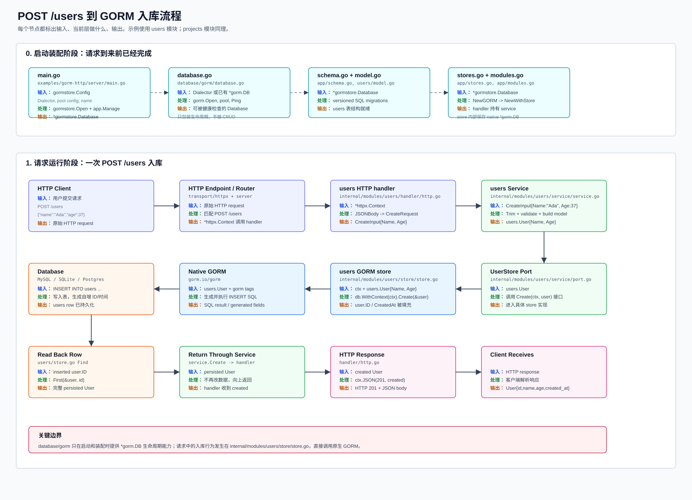

# HTTP 到 GORM 入库流程

这份图用 `POST /users` 举例，说明一个新的 HTTP 请求最终通过 GORM 入库时，每一层的输入、处理和输出。



## 调用链

```text
POST /users
-> transport/httpx 路由
-> internal/modules/users/handler/http.go
-> internal/modules/users/service/service.go
-> internal/modules/users/service/port.go
-> internal/modules/users/store/store.go
-> already-injected native *gorm.DB
-> *gorm.DB.Create
-> MySQL / SQLite / Postgres
-> store.Find 读回完整行
-> HTTP 201 JSON
```

## 每层职责

| 层 | 文件 | 输入 | 当前层做什么 | 输出 |
| --- | --- | --- | --- | --- |
| HTTP 路由 | `transport/httpx` / `server` | 原始 HTTP request | 匹配 `POST /users`，构造 `*httpx.Context` | 调用 users handler |
| Handler | `internal/modules/users/handler/http.go` | `*httpx.Context`，JSON body | `JSONBody` 解析到 `CreateRequest`，转换成 service input | `CreateInput{Name, Age}` |
| Service | `internal/modules/users/service/service.go` | `CreateInput` | trim、校验业务输入，构造 `users.User` | `users.User{Name, Age}` |
| Port | `internal/modules/users/service/port.go` | `users.User` | 定义 `Create(ctx, user)` 这个业务持久化接口 | 调用具体 store |
| GORM Store | `internal/modules/users/store/store.go` | `ctx + users.User` | `db.WithContext(ctx).Create(&user)`，再按 ID `Find` | 完整 persisted `User` |
| GORM Resource | `database/gorm/database.go` | `gormstore.Database` | 在装配时提供 native `*gorm.DB`；请求中不做 CRUD | `*gorm.DB` |
| Native GORM | `gorm.io/gorm` | model + GORM tags | 根据 dialector 生成并执行 SQL | SQL result / generated fields |
| Database | MySQL 等 | `INSERT INTO users ...` | 写入表，生成自增 ID、时间等 | 持久化 row |
| Response | `handler/http.go` | persisted `User` | `ctx.JSON(http.StatusCreated, created)` | HTTP 201 JSON |

关键点：`database/gorm` 不是 CRUD 框架，只是 GORM 连接生命周期封装。真正的入库代码在模块自己的 `store.go`，直接使用原生 GORM。
