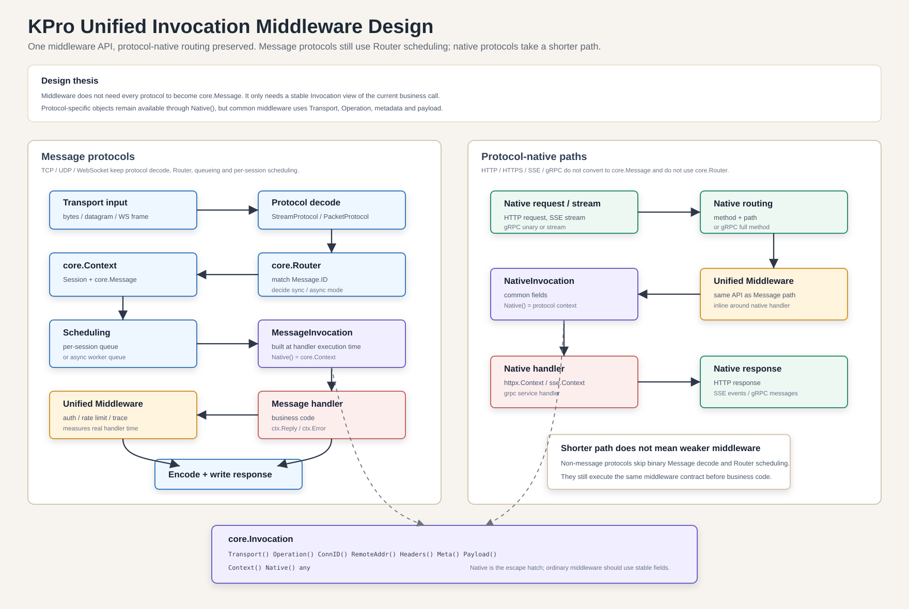

# Invocation middleware design

This document describes the unified middleware model used by KPro.



## Problem

KPro supports two broad runtime shapes:

```text
message protocols: TCP / UDP / WebSocket -> core.Message -> core.Router -> core.Context
native protocols:  HTTP / HTTPS / SSE / gRPC -> protocol-native route or interceptor
```

The framework should not force HTTP, SSE or gRPC to become `core.Message`. At the same time, users should not need two different middleware concepts for common concerns such as recovery, auth, trace, logging and rate limiting.

The unified rule is:

```text
middleware wraps one business invocation and decides whether to call next
```

## Core API

`core.Middleware` now wraps `core.Invocation`:

```go
type Invocation interface {
    Context() context.Context
    Transport() Transport
    Operation() string
    ConnID() uint64
    RemoteAddr() string
    Headers() map[string]string
    Meta() map[string]any
    Payload() any
    Native() any
    Set(key string, value any)
    Get(key string) (any, bool)
}

type InvocationHandler func(Invocation) error
type Middleware func(InvocationHandler) InvocationHandler
```

`Invocation` is not a replacement for every protocol-specific context. It is the stable cross-protocol view used by middleware.

Protocol-specific business code still keeps its native handler type:

```text
TCP / UDP / WebSocket handler  -> core.Context
HTTP / HTTPS handler           -> httpx.Context
SSE handler                    -> sse.Context
gRPC handler                   -> generated gRPC service method
```

`Native()` is the escape hatch:

```text
TCP / UDP / WebSocket Native() -> core.Context
HTTP / HTTPS Native()          -> *httpx.Context
SSE Native()                   -> *sse.Context
gRPC unary Native()            -> kprogrpc.UnaryInvocationNative
gRPC stream Native()           -> kprogrpc.StreamInvocationNative
```

Common middleware should prefer stable fields such as `Transport`, `Operation`, `Headers`, `Meta` and `Payload`. Protocol-specific middleware can inspect `Native()` when needed.


## Message protocol flow

TCP, UDP and WebSocket keep the current message flow:

```text
transport input
  -> protocol decode
  -> core.Context
  -> core.Router.Dispatch
  -> queue / scheduling
  -> build MessageInvocation
  -> unified core.Middleware chain
  -> message business handler
  -> ctx.Reply / ctx.Error
  -> protocol encode
  -> transport output
```

The important detail is where middleware runs. For message protocols, middleware runs at actual handler execution time, after Router scheduling, not outside `Router.Dispatch`.

That preserves the meaning of middleware timing and panic recovery:

```text
middleware duration = real business handler duration
middleware recovery = catches real business handler panic
```

## Protocol-native flow

HTTP, HTTPS, SSE and gRPC do not become `core.Message`.

Their flow stays shorter:

```text
native protocol request / stream
  -> native route match or interceptor
  -> build NativeInvocation
  -> unified core.Middleware chain
  -> native business handler
  -> native response / stream messages
```

Examples:

```text
HTTP      Operation = "POST /echo"                Native = *httpx.Context
SSE       Operation = "GET /events"               Native = *sse.Context
gRPC      Operation = "/pkg.Service/Method"       Native = gRPC native wrapper
TCP       Operation = "message/100"               Native = core.Context
```

## What stays different

This design unifies middleware, not routing.

| Area | Message protocols | Native protocols |
|---|---|---|
| Transport parsing | KPro binary protocol | HTTP, SSE or gRPC runtime |
| Routing | `core.Router` by `Message.ID` | native method/path or gRPC method |
| Scheduling | per-session queue / async queue | protocol runtime call stack |
| Business context | `core.Context` | `httpx.Context`, `sse.Context`, gRPC handler args |
| Middleware context | `core.Invocation` | `core.Invocation` |

So the rule is:

```text
routing remains protocol-specific
middleware becomes invocation-specific
```

## User API

The preferred user-facing API is one middleware entry point:

```go
app := server.New()
app.Use(middleware.Recover(), middleware.RateLimit(...))
```

This applies to endpoints mounted before or after the call:

```text
TCP, UDP, WebSocket, HTTP, HTTPS, SSE, gRPC unary, gRPC stream
```

Rate limiting can be scoped by the middleware users choose:

| Middleware | Scope |
|---|---|
| `middleware.RateLimit` | one shared bucket for every invocation using that middleware instance |
| `middleware.ConnRateLimit` | one bucket per `Invocation.ConnID()` |
| `middleware.IPRateLimit` | one bucket per `Invocation.RemoteAddr()` IP; remote ports are ignored |
Endpoint-level `Use` scopes middleware to one endpoint:

```go
app.TCP(":8088").Use(middleware.MaxPayload(64 * 1024))
```

All universal-server endpoints use `core.Middleware`; native protocols keep native business handlers, not native middleware APIs.
