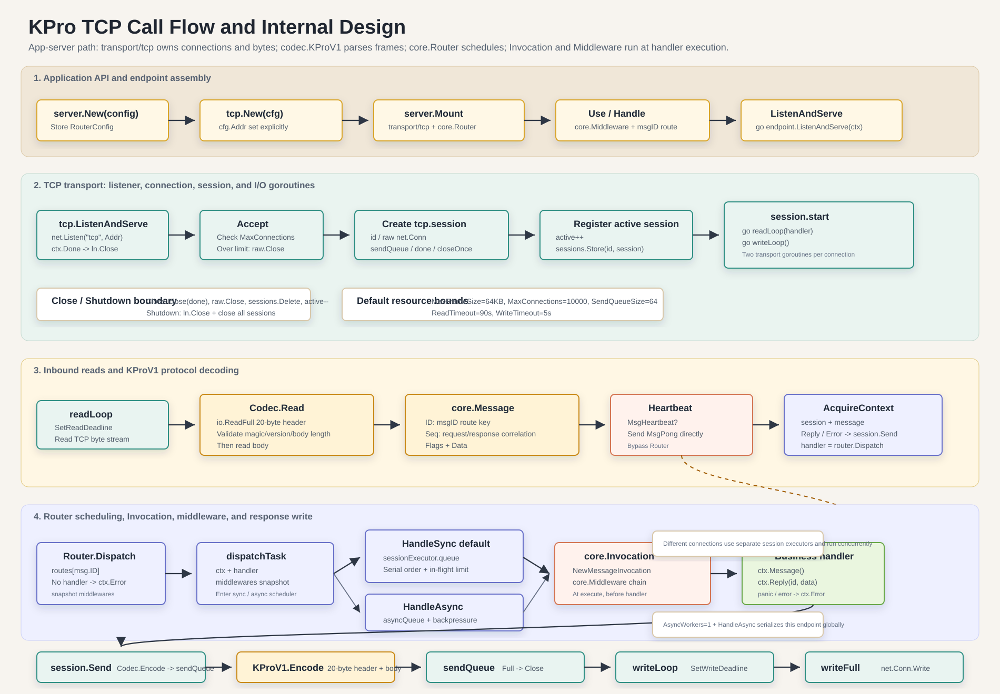

# TCP Internal Flow

TCP is the clearest entry point for understanding the KPro application server
because it exercises the complete Message path:

```text
connection -> stream protocol decoding -> core.Message -> core.Context
  -> router scheduling -> core.Invocation -> core.Middleware -> business handler
  -> response Message -> protocol encoding -> client write
```

UDP and WebSocket receive different network units, but they reuse the same
`core.Message`, `core.Context`, `core.Router`, `core.Invocation` middleware,
and handler model. After understanding TCP, the main differences are therefore
inside each transport.

## Diagram



The diagram is available directly as a scalable
[SVG asset](assets/kpro-tcp-flow.svg).

## Key Files

| Area | Files | Responsibility |
| --- | --- | --- |
| Assembly | `server/server.go` | Mount abstract message transports, create endpoint routers, and start runners. |
| TCP transport | `transport/tcp/server.go`, `transport/tcp/batch_writer.go` | Listen, accept connections, create sessions, read messages, and perform segmented or batched writes. |
| Protocol | `codec/kpro.go`, `codec/kpro_segmented.go` | Decode KProV1 frames, encode contiguous frames, and encode fixed headers. |
| Outbound resources | `transport/internal/outbound/`, `transport/internal/bufferpool/` | Bound queued frames and bytes, drain batches, and reuse transport-owned payload storage. |
| Context | `core/context.go` | Present `Session + Message` to a handler as a context. |
| Routing | `core/router.go` | Find a handler by `Message.ID`, snapshot middleware, schedule sync or async work, and create `core.Invocation` at execution time. |
| Session contract | `core/session.go` | Provide transport-neutral send, close, and connection identity operations. |

## Assembly and Startup

Applications usually begin with `server.New()`, `tcp.New(...)`, and
`app.Mount(...)`:

```go
app := server.New()
tcpEndpoint := app.Mount(tcp.New(tcp.Config{Addr: ":8088"}))
tcpEndpoint.HandleSync(100, func(ctx core.Context) error {
	return ctx.Reply(ctx.Message().ID, ctx.Message().Data)
})
err := app.ListenAndServe()
```

Before network traffic starts, assembly follows this path:

```text
server.New()
  -> tcp.New(cfg)
  -> app.Mount(tcpServer)
  -> Endpoint{transport: tcpServer, router: core.NewRouter(...)}
  -> Endpoint.HandleSync(...)
  -> router.HandleSync(msgID, handler)
```

`server` only knows the shared `transport.MessageServer` contract. The
application imports TCP explicitly, so an application that does not use TCP
does not inherit it as a compile dependency.

The endpoint primarily owns two values at this stage:

- `transport/tcp.Server` listens on the socket and manages TCP sessions.
- `core.Router` owns message routes, middleware, and sync or async scheduling
  queues.

After `app.ListenAndServe()`:

```text
server.Server.ListenAndServe()
  -> start one goroutine for each mounted runner
  -> Endpoint.ListenAndServe(ctx)
  -> tcp.Server.ListenAndServe(ctx, endpoint.router.Dispatch)
```

The TCP transport does not know the business routes. It receives one
`core.Handler`; on a standard endpoint that handler is `router.Dispatch`.

## TCP Connection Lifecycle

`transport/tcp.Server.ListenAndServe` runs the accept loop:

```text
net.Listen("tcp", addr)
  -> ln.Accept()
  -> create tcp.session
  -> session.start(router.Dispatch)
```

Each connection becomes a `tcp.session` containing:

- `id`: the connection or session ID;
- `raw`: the underlying `net.Conn`;
- `sendQueue`: a bounded queue of encoded outbound frames;
- `done`: the close signal.

The session starts two goroutines:

```text
session.readLoop(handler)
session.writeLoop()
```

Every connection therefore has its own reader and writer. Separate connections
can run concurrently. Per-connection ordering is determined by Router
scheduling, not by a single global TCP accept queue.

## Reading and Protocol Decoding

The read path lives in `transport/tcp/server.go`:

```text
session.readLoop
  -> apply the read deadline when required
  -> Codec.Read(rawConn, MaxFrameSize)
  -> obtain core.Message
  -> handle heartbeat directly
  -> core.AcquireContext(session, msg)
  -> handler(ctx)
```

The default `codec.KProV1Codec.Read` reads one complete frame from the TCP
stream:

```text
read the 20-byte header
  -> validate magic and version
  -> parse flags, message ID, sequence, and body length
read the body bytes
  -> return codec.ReadResult{Message, Bytes}
```

The KProV1 header is:

```text
uint16 magic      0x4b50
uint8  version    1
uint8  flags
uint32 message id
uint64 sequence
uint32 body length
bytes  body
```

TCP is a byte stream and does not preserve application message boundaries. One
frame may arrive across several reads, or several frames may be available in
one read. The `codec.StreamCodec` contract makes `Codec.Read` responsible for
recovering exactly one complete KProV1 frame.

## Message to Context

After decoding, the transport turns the message into a context:

```go
msg := result.Message
_ = handler(core.AcquireContext(s, msg))
```

Here `s` is the current `tcp.session`. `AcquireContext` borrows a
`core.BaseContext` from an internal pool and assigns the session and message.
The Router clears and returns it to the pool after execution or rejection,
reducing temporary allocation per message:

```go
func AcquireContext(session Session, message Message) *BaseContext {
	ctx := baseContextPool.Get().(*BaseContext)
	// reset session, message, and handler-local values
	return ctx
}
```

A borrowed context is valid only for the current handler invocation. A
background goroutine that must retain the message or context values must first
call `core.CloneContext(ctx)`. The clone copies message data, headers, metadata
containers, and handler-local values.

The context is not another protocol object. It combines the active connection
with its decoded message:

```text
Context
  session: current TCP session
  message: decoded core.Message
  values:  optional handler-local key/value storage
```

This is the boundary between transport I/O and application logic.

## Router Scheduling

The endpoint passes `router.Dispatch(ctx)` as the TCP handler. Dispatch follows
this path:

```text
ctx.Message()
  -> find a route by Message.ID
  -> no route: ctx.Error(ErrNoHandler)
  -> route found: load the precompiled middleware handler
  -> create dispatchTask{ctx, invocationHandler, sessionExecutor}
  -> sync route: enqueue on this session's serial executor
  -> async route: enqueue on the global async worker queue
  -> execute task: construct NewMessageInvocation
  -> core.Middleware chain
  -> business handler
```

Middleware chains are built when a route is registered or `Use` changes the
configuration, not for every dispatch. Chain construction runs outside the
Router lock, so a middleware constructor may safely call Router configuration
APIs. The resulting handler is reused concurrently and must keep its own state
concurrency-safe.

### Synchronous Routes

`HandleSync` enqueues the task on the current connection's `sessionExecutor`.
For one TCP connection:

```text
request A -> request B -> request C
```

execution remains ordered:

```text
handler(A) -> handler(B) -> handler(C)
```

Sync routes therefore preserve handler order within one connection. Different
connections have different session executors and can still run in parallel.

### Asynchronous Routes

`HandleAsync` places the task on the Router's global async worker queue. For
one connection:

```text
request A -> request B
```

The server still reads and dispatches A before B, but completion may be:

```text
response B -> response A
```

This out-of-order completion is the expected async-route contract.

## Outbound Write Path

Business handlers respond through the context:

```go
ctx.Reply(msgID, data)
ctx.Error(text)
```

`ctx.Reply` creates a response `core.Message` and calls the active session:

```text
ctx.Reply
  -> session.Send(core.Message{ID, Seq: request.Seq, Data})
  -> KProV1: inline header + transport-owned payload copy
     other codecs: Codec.Encode(response Message)
  -> sendQueue <- outbound frame
```

The TCP writer goroutine performs socket I/O:

```text
session.writeLoop
  -> take the first queued frame and non-blockingly drain a bounded FIFO prefix
  -> split by MaxWriteBatchFrames / MaxWriteBatchBytes
  -> apply the write deadline for each batch
  -> net.Buffers.WriteTo(rawConn) gathers header and payload regions
```

This design decouples handlers from socket writes. A slow client does not block
the handler while `sendQueue` still has frame and byte capacity. If capacity
is exhausted, `session.Send` closes the session and returns
`core.ErrSendQueueFull`. Ordinary `Session.Send` copies the caller's payload
before returning, so the caller may safely reuse its slice. See
[Performance Fast Paths](performance-fast-path.md) for explicit
ownership-transfer APIs.

## Echo Request: Data Transformations

Assume the client sends this logical message:

```text
ID    = 100
Seq   = 42
Flags = 0
Data  = "hello"
```

### 1. The Client Encodes a KProV1 Frame

The encoded values are:

```text
magic       0x4b50
version     1
flags       0
message id  100
sequence    42
body length 5
body        "hello"
```

The data is now a TCP byte stream:

```text
[]byte{
  header(20 bytes),
  'h', 'e', 'l', 'l', 'o',
}
```

### 2. `readLoop` Reads from `net.Conn`

The frame may arrive in one read or across several reads. That difference is
not visible above the codec.

```text
raw TCP bytes
```

No `core.Message` exists yet.

### 3. `Codec.Read` Produces `core.Message`

After reading the header and body, `codec.KProV1Codec.Read` returns:

```go
codec.ReadResult{
	Message: core.Message{
		ID:    100,
		Seq:   42,
		Flags: 0,
		Data:  []byte("hello"),
	},
	Bytes: 25,
}
```

The shape changes at the protocol boundary:

```text
raw bytes -> core.Message
```

### 4. TCP Creates `core.Context`

`readLoop` calls:

```go
ctx := core.AcquireContext(session, msg)
```

The handler observes:

```text
Context
  Session()    -> current TCP session
  Message()    -> {ID:100, Seq:42, Flags:0, Data:"hello"}
  Transport()  -> core.TransportTCP
  ConnID()     -> session ID
  RemoteAddr() -> client address
```

The context boundary changes the shape to:

```text
core.Message -> core.Context{session, message}
```

### 5. Router Creates `dispatchTask`

`router.Dispatch(ctx)` looks up the route for `Message.ID=100`. Assume a
synchronous echo route:

```go
endpoint.HandleSync(100, func(ctx core.Context) error {
	msg := ctx.Message()
	return ctx.Reply(msg.ID, msg.Data)
})
```

The Router creates:

```text
dispatchTask
  ctx     -> Context{session, Message{ID:100, Seq:42, Data:"hello"}}
  handler -> wrapped echo handler
  session -> this connection's sessionExecutor
```

The scheduling boundary changes the shape to:

```text
core.Context -> dispatchTask
```

### 6. The Sync Executor Runs the Handler

After the current session executor dequeues the task, `Router.execute` creates
`core.NewMessageInvocation`, runs the `core.Middleware` chain, and invokes the
business handler.

```go
msg := ctx.Message()
```

The handler receives:

```text
ID=100, Seq=42, Data="hello"
```

Business code does not need to know whether the message came from TCP, UDP, or
WebSocket unless it explicitly calls `ctx.Transport()`.

### 7. `ctx.Reply` Creates the Response Message

The handler calls:

```go
ctx.Reply(100, []byte("hello"))
```

`ctx.Reply` preserves the request sequence:

```go
core.Message{
	ID:   100,
	Seq:  42,
	Data: []byte("hello"),
}
```

The response boundary changes the shape to:

```text
handler result -> response core.Message
```

### 8. `session.Send` Encodes and Enqueues the Frame

`session.Send` uses the same stream protocol:

```text
response core.Message
  -> 20-byte inline KProV1 header
  +  transport-owned payload
  -> sendQueue
```

The outbound boundary changes the shape to:

```text
response core.Message -> segmented outbound frame
```

The handler has now completed. The response may still be waiting in the
session's bounded `sendQueue`.

### 9. `writeLoop` Writes to the Client

The writer takes a bounded FIFO batch:

```text
sendQueue -> net.Buffers{header, payload, ...}.WriteTo(net.Conn)
```

After decoding the response, the client obtains:

```text
ID=100, Seq=42, Data="hello"
```

The synchronous echo path preserves these invariants:

```text
client_sent frame == server_received frame
server_sent frame == client_received frame
request Seq == response Seq == 42
request Data == response Data == "hello"
```

## Special Paths

### Heartbeat

The TCP `readLoop` handles heartbeat messages without entering the Router:

```text
MsgHeartbeat -> session.Send(MsgPong) -> continue
```

Heartbeat traffic therefore does not run middleware or a business handler.

### No Handler

If `router.Dispatch` cannot find a route for `Message.ID`, it writes a
framework error:

```text
ID   = core.MsgError
Seq  = original request sequence
Data = "no handler"
```

The request has been decoded and wrapped in a context, but no business handler
runs.

### Queue Full or Too Many In Flight

If a scheduling queue is full or a request exceeds
`MaxInflightPerSession` or global `MaxInflight`, the Router sends an error
through the current context and session. The global admission error is
`core.ErrGlobalInflightLimit`:

```text
ID   = core.MsgError
Seq  = original request sequence
Data = specific framework error text
```

The error uses the normal outbound path:

```text
ctx.Error -> session.Send -> outbound frame -> sendQueue -> batch writeLoop
```

## Framework Responsibilities Seen Through TCP

The TCP path exposes the framework's ownership boundaries:

```text
transport    owns I/O, connections, and session lifecycle
protocol     owns bytes <-> Message
context      exposes the current connection and message to application code
router       owns route lookup, precompiled middleware, sync/async scheduling,
             and Invocation creation at handler execution
handler      owns business behavior
session.Send hands a response back to the transport for writing
```

UDP and WebSocket reuse this core model:

- UDP replaces the TCP byte stream with datagrams and maps remote `IP:port`
  values to virtual sessions. Every virtual session has its own `sendQueue`
  and `writeLoop`.
- WebSocket replaces TCP framing with WebSocket messages and reassembles
  continuation frames.
- Both ultimately enter
  `core.Message -> core.Context -> router.Dispatch`.

TCP is therefore the most complete internal flow example, not a separate
business programming model.
