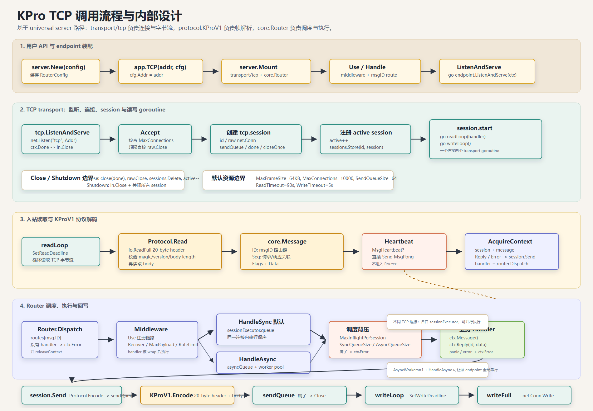

# TCP 内部流程

本文以 TCP 作为入口，说明当前 KPro app server 的核心流程。TCP 是理解整个工程的最佳切入点，因为它完整经过了这条消息链路：

```text
连接 -> 流式协议解码 -> core.Message -> core.Context
  -> router 调度 -> core.Invocation -> core.Middleware -> 业务 handler
  -> 响应 Message -> 协议编码 -> 写回客户端
```

UDP 和 WebSocket 的网络输入形式不同，但它们复用同一套 `core.Message`、`core.Context`、`core.Router`、`core.Invocation` middleware 和 handler 模型。因此理解 TCP 后，再看 UDP/WebSocket，主要差异就在 transport 层。

## 流程图



SVG 源文件在 [kpro-tcp-flow.svg](assets/kpro-tcp-flow.svg)。

## 关键文件

| 模块 | 文件 | 职责 |
| --- | --- | --- |
| 组装层 | `server/server.go` | 挂载 TCP transport，创建 endpoint router，启动 runner |
| TCP transport | `transport/tcp/server.go` | 监听、accept、创建 session、读循环、写循环 |
| 协议层 | `codec/kpro.go` | KProV1 frame 的解码和编码 |
| 上下文 | `core/context.go` | 把 `Session + Message` 包装成 handler 可用的 context |
| 路由调度 | `core/router.go` | 按 `Message.ID` 找 handler，快照 middleware，同步/异步调度，并在执行点构造 `core.Invocation` |
| 会话抽象 | `core/session.go` | transport 无关的发送、关闭、连接标识接口 |

## 启动阶段

业务通常从 `server.New()` 和 `app.TCP(...)` 开始：

```go
app := server.New()
tcpEndpoint := app.TCP(":8088")
tcpEndpoint.HandleSync(100, func(ctx core.Context) error {
	return ctx.Reply(ctx.Message().ID, ctx.Message().Data)
})
err := app.ListenAndServe()
```

启动前的组装流程是：

```text
server.New()
  -> app.TCP(addr, cfg)
  -> tcp.New(cfg)
  -> server.Mount(tcpServer)
  -> Endpoint{transport: tcpServer, router: core.NewRouter(...)}
  -> Endpoint.HandleSync(...)
  -> router.HandleSync(msgID, handler)
```

这一步还没有网络流量。endpoint 主要持有两个对象：

- `transport/tcp.Server`：负责监听 socket、管理 TCP session。
- `core.Router`：负责消息路由、middleware、同步/异步调度队列。

调用 `app.ListenAndServe()` 后：

```text
server.Server.ListenAndServe()
  -> 每个已挂载 runner 各启动一个 goroutine
  -> Endpoint.ListenAndServe(ctx)
  -> tcp.Server.ListenAndServe(ctx, endpoint.router.Dispatch)
```

这里有一个关键点：TCP transport 不直接知道业务路由。它只接收一个 `core.Handler`。在标准 endpoint 中，这个 handler 就是 `router.Dispatch`。

## TCP 连接阶段

`transport/tcp.Server.ListenAndServe` 运行 accept 循环：

```text
net.Listen("tcp", addr)
  -> ln.Accept()
  -> 创建 tcp.session
  -> session.start(router.Dispatch)
```

每个 TCP 连接都会变成一个 `tcp.session`，内部包含：

- `id`：连接/session ID。
- `raw`：底层 `net.Conn`。
- `sendQueue`：有界响应队列，元素是已经编码好的响应 frame。
- `done`：关闭信号。

session 会启动两个 goroutine：

```text
session.readLoop(handler)
session.writeLoop()
```

因此每个 TCP 连接都有自己的 reader 和 writer。不同连接之间天然可以并行；是否串行，主要看 router 调度层如何处理，而不是 TCP accept 层统一排队。

## 读取与协议解码

读侧核心在 `transport/tcp/server.go`：

```text
session.readLoop
  -> 设置 read deadline
  -> Codec.Read(rawConn, MaxFrameSize)
  -> 得到 core.Message
  -> heartbeat 特判
  -> core.AcquireContext(session, msg)
  -> handler(ctx)
```

默认协议是 `codec.KProV1Codec.Read`。它从 TCP 字节流中读取一个完整 frame：

```text
读取 20 字节 header
  -> 校验 magic/version
  -> 解析 flags、msg id、seq、body length
读取 body bytes
  -> 返回 codec.ReadResult{Message, Bytes}
```

KProV1 header 格式：

```text
uint16 magic      0x4b50
uint8  version    1
uint8  flags
uint32 message id
uint64 sequence
uint32 body length
bytes  body
```

TCP 是流协议，不保留应用层消息边界。一次应用消息可能被拆成多次网络读取，也可能多条消息被合并到一次网络读取中。因此 TCP 这里使用 `codec.StreamCodec`，由 `Codec.Read` 负责恢复一个完整 KProV1 frame。

## Message 转 Context

协议解码后，真正把消息变成上下文的是这一步：

```go
msg := result.Message
_ = handler(core.AcquireContext(s, msg))
```

这里的 `s` 是当前 `tcp.session`。`AcquireContext` 从内部对象池借用一个
`core.BaseContext`，填入当前 session 和 message；router 在任务执行或拒绝后
把它清空并归还对象池，以降低每条消息的临时分配：

```go
func AcquireContext(session Session, message Message) *BaseContext {
	ctx := baseContextPool.Get().(*BaseContext)
	// reset session, message and handler-local values
	return ctx
}
```

借用的 context 只在当前 handler 调用期间有效。后台 goroutine 若需要保留
message 或 context values，必须先调用 `core.CloneContext(ctx)`；clone 会复制
message data、headers、meta 容器和 handler-local values。

因此 context 不是新的协议对象，它只是把当前连接和当前消息组合起来：

```text
Context
  session: 当前 TCP session
  message: 解码后的 core.Message
  values:  handler 内部可选的 key/value 存储
```

这是 transport 世界进入业务世界的边界。

## Router 调度阶段

TCP 传入的 handler 在 endpoint 中实际是 `router.Dispatch(ctx)`。

Dispatch 的核心流程：

```text
ctx.Message()
  -> 按 Message.ID 查找 route
  -> 没有 route：ctx.Error(ErrNoHandler)
  -> 找到 route：读取预编译的 middleware handler
  -> 创建 dispatchTask{ctx, invocationHandler, sessionExecutor}
  -> sync route：进入当前 session 的串行队列
  -> async route：进入全局 async worker 队列
  -> execute task：构造 NewMessageInvocation
  -> core.Middleware 链
  -> 业务 handler
```

middleware 链在 route 注册或 `Use` 配置变化时构建，不在每次 dispatch 时
重复组合。构建在 router 锁外完成，因此 middleware 构造器可以安全地回调
router 配置 API；构造出的 handler 会被并发复用，其内部状态需要并发安全。

### 同步 route

`HandleSync` 会把 task 放入当前连接对应的 `sessionExecutor`。

对于同一个 TCP 连接：

```text
request A -> request B -> request C
```

同步执行顺序是：

```text
handler(A) -> handler(B) -> handler(C)
```

也就是说，sync 保证单连接内的处理顺序。不同 TCP 连接有不同的 `sessionExecutor`，仍然可以并行。

### 异步 route

`HandleAsync` 会把 task 放入 router 的全局 async worker 队列。

对于同一个 TCP 连接：

```text
request A -> request B
```

服务端读取和 dispatch 的顺序仍然是 A 再 B，但响应完成顺序可能是：

```text
response B -> response A
```

只要 B 的 handler 先执行完，就会先返回。这是 async route 的预期语义。

## 写回阶段

业务 handler 通过 context 发送响应：

```go
ctx.Reply(msgID, data)
ctx.Error(text)
```

`ctx.Reply` 会构造响应 `core.Message`，并调用当前 session：

```text
ctx.Reply
  -> session.Send(core.Message{ID, Seq: request.Seq, Data})
  -> Codec.Encode(response Message)
  -> sendQueue <- encoded frame
```

真正写 socket 的是 TCP 写 goroutine：

```text
session.writeLoop
  -> 从 sendQueue 取出 encoded frame
  -> 设置 write deadline
  -> writeFull(rawConn, frame)
```

这个设计把业务 handler 和网络写入解耦。客户端读得慢时，只要 `sendQueue` 还有容量，handler 不会直接卡在 socket write 上；但如果 `sendQueue` 填满，`session.Send` 会关闭 session 并返回 `core.ErrClosed`。

## 示例：一次 Echo 请求的数据变化

假设客户端发送一条逻辑消息：

```text
ID    = 100
Seq   = 42
Flags = 0
Data  = "hello"
```

### 1. 客户端编码 KProV1 frame

发送前，消息会被编码成：

```text
magic       0x4b50
version     1
flags       0
msg id      100
seq         42
body length 5
body        "hello"
```

此时数据形态是 TCP 字节流：

```text
[]byte{
  header(20 bytes),
  'h', 'e', 'l', 'l', 'o',
}
```

### 2. TCP readLoop 从 net.Conn 读取

TCP session 从 `net.Conn` 中读取字节。由于 TCP 是流，frame 可能一次读完整，也可能分几次读完。这一点对上层不可见。

此时数据形态仍然是：

```text
raw TCP bytes
```

还没有 `core.Message`。

### 3. Codec.Read 生成 core.Message

`codec.KProV1Codec.Read` 读取 header 和 body 后返回：

```go
codec.ReadResult{
	Message: core.Message{
		ID:    100,
		Seq:   42,
		Flags: 0,
		Data:  []byte("hello"),
	},
	Bytes: 25,
}
```

数据形态变化为：

```text
raw bytes -> core.Message
```

这是协议边界。

### 4. TCP 创建 core.Context

`readLoop` 调用：

```go
ctx := core.AcquireContext(session, msg)
```

此时 handler 看到的是：

```text
Context
  Session()    -> 当前 TCP session
  Message()    -> {ID:100, Seq:42, Flags:0, Data:"hello"}
  Transport()  -> core.TransportTCP
  ConnID()     -> session id
  RemoteAddr() -> client address
```

数据形态变化为：

```text
core.Message -> core.Context{session, message}
```

这是上下文边界。

### 5. Router 创建 dispatchTask

`router.Dispatch(ctx)` 根据 `Message.ID=100` 查找 route。

假设注册的是同步 echo route：

```go
endpoint.HandleSync(100, func(ctx core.Context) error {
	msg := ctx.Message()
	return ctx.Reply(msg.ID, msg.Data)
})
```

Router 会创建：

```text
dispatchTask
  ctx     -> Context{session, Message{ID:100, Seq:42, Data:"hello"}}
  handler -> wrapped echo handler
  session -> 当前 TCP 连接对应的 sessionExecutor
```

数据形态变化为：

```text
core.Context -> dispatchTask
```

这是调度边界。

### 6. sync executor 执行业务 handler

当前连接的 sync executor 取出 task 后，`Router.execute` 会先构造 `core.NewMessageInvocation`，再执行 `core.Middleware` 链，最后进入业务 handler。

handler 内部通过：

```go
msg := ctx.Message()
```

拿到：

```text
ID=100, Seq=42, Data="hello"
```

业务层不需要关心这个消息来自 TCP、UDP 还是 WebSocket；只有主动调用 `ctx.Transport()` 时才会感知 transport 类型。

### 7. ctx.Reply 构造响应 Message

handler 调用：

```go
ctx.Reply(100, []byte("hello"))
```

`ctx.Reply` 会保留请求的 `Seq`：

```go
core.Message{
	ID:   100,
	Seq:  42,
	Data: []byte("hello"),
}
```

数据形态变化为：

```text
handler result -> response core.Message
```

这是响应消息边界。

### 8. session.Send 编码并进入 sendQueue

`session.Send` 使用同一个 stream protocol 编码响应：

```text
response core.Message
  -> Codec.Encode
  -> []byte KProV1 frame
  -> sendQueue
```

数据形态变化为：

```text
response core.Message -> encoded response bytes
```

到这里 handler 已经结束。响应可能还在当前 session 的有界 `sendQueue` 中等待写出。

### 9. writeLoop 写回客户端

写 goroutine 从 `sendQueue` 中取出 frame：

```text
sendQueue -> writeFull(net.Conn, frame)
```

客户端收到 KProV1 frame 后解码得到：

```text
ID=100, Seq=42, Data="hello"
```

这个同步 echo 示例需要满足的核心不变量是：

```text
client_sent frame == server_received frame
server_sent frame == client_received frame
request Seq == response Seq == 42
request Data == response Data == "hello"
```

## 特殊路径

### Heartbeat

Heartbeat 在 TCP `readLoop` 中直接处理，不进入 router：

```text
MsgHeartbeat -> session.Send(MsgPong) -> continue
```

因此 heartbeat 不经过 middleware，也不会进入业务 handler。

### No Handler

如果 `router.Dispatch` 找不到 `Message.ID` 对应的 route，会返回框架错误响应：

```text
ID   = core.MsgError
Seq  = 原请求 Seq
Data = "no handler"
```

此时请求已经被解码并包装成 context，但不会进入业务 handler。

### Queue Full / Too Many In-Flight

如果调度时队列满，或者超过单 session 的 `MaxInflightPerSession` / 全局
`MaxInflight`，router 会通过当前 context/session 发错误响应。对应的全局
准入错误是 `core.ErrGlobalInflightLimit`：

```text
ID   = core.MsgError
Seq  = 原请求 Seq
Data = 具体框架错误文本
```

错误响应仍然走正常写回链路：

```text
ctx.Error -> session.Send -> Codec.Encode -> sendQueue -> writeLoop
```

## 通过 TCP 看整个框架

TCP 路径体现了当前工程的职责划分：

```text
transport 负责 I/O、连接、session 生命周期
protocol 负责 bytes <-> Message
context 负责把当前连接和当前消息暴露给业务
router 负责 route 查找、预编译 middleware、同步/异步调度，并在 handler 执行点创建 Invocation
handler 负责业务逻辑
session.Send 负责把响应交回 transport 写出
```

UDP 和 WebSocket 复用同一套核心模型：

- UDP 把 TCP 字节流替换为 datagram，并用远端 `IP:port` 映射 virtual session；每个 virtual session 现在也有独立的 `sendQueue` 和 `writeLoop`。
- WebSocket 把 TCP frame 边界替换为 WebSocket message，并支持 continuation frame 重组。
- 两者最终都会进入 `core.Message -> core.Context -> router.Dispatch`。

因此 TCP 是最完整的内部流程样本，但不是一套独立的业务编程模型。


